

球谐函数（Spherical Harmonics）是一种定义在单位球面上的函数表达方式，其在图形学领域中有大量应用，本身是因为他能满足图形学中广泛存在的“方向+大小”结合表达的需求，比如他最广为人知的应用，是在全局光照系统中，用作空间中光照探针（probe）的表达方式。
不过本文要介绍的是SH的一种更少见的使用方式：“用作降噪之后的表面细节增强”，这也是笔者这段实习期间的一个重要工作方向，用本篇博客简单总结一下。
本文会主要包含以下几个方向：
- 光追降噪的思路：这部分主要是提供一些简单的背景信息，不会详细展开降噪器的实现
- SH & SG理论介绍：我们会在这部分详细展开SH的一些数学表达和属性，并介绍另一种在如今主流实现中经常用来替代SH的表示形式：球形高斯（Spherical Gaussian）。*笔者会尽量解释得清楚易懂，不涉及太多看着就头大的数学公式；不过跳过也没关系，后续部分会给实现版本的简化模型*
- 实现：这部分则是给出上述理论模型在工程场景的落地细节，工程简化，以及效果展示。
# 一、降噪思路与现存问题
无论是在实时领域还是离线领域，光追降噪一直都是一个非常重要的问题，其和超分、插帧等算法一直面向的都是光追算法一个更核心的诉求：如何用尽可能少的采样次数得到质量更高的图像。最近大热的DLSS技术其实也是在用AI方案给出对这个问题的回答，DLSS4.5中的光线重构Ray Reconstruction就有面向光追的AI降噪器。但在笔者的实践中，DLSS的降噪器存在明显的抹除细节的问题，且稳定性欠佳（在我们的测试中确实存在降不下去噪的情况），因此我们用的则是可解释性更强的传统降噪方案。
本文的方案是基于英伟达实现的Nvidia Real-time Denoiser（NRD）中的Relax降噪器。具体的实现和pass我们不在这里展开，只需要知道其中最核心的两个步骤：Temporal Accumulation和Spatial Filter（Relax中称为Atrous）。我们可以很简单理解这里的思路，时序累积是将过往的渲染结果与当前帧做线性插值，而spatial filter则是在此基础上对还存在噪声的图像做空间滤波，本质都是为了达成“样本复用”这一个目标。
尽管在实际实现中，Spatial Filter的shader存在大量的启发式，用来降低在法线、受光照程度、颜色等像素样本条件不同时样本的复用率，也就是“保留细节、突出边界”。但从信号本质上来讲，降噪的本质本身就是在抹除高频信息，而最理想的降噪则是在场景（纹理）细节和噪声之间找一个精准的频率边界，频率低于边界的保留、高于的则不要。这本身就很难通过解析的方式找得到，所以通过数据驱动（AI）的方式去拟合这个边界本身也是很合理的思路。不过更治本的方式则是我们直接在降噪前剥离细节，只对低频的光照量（irradiance）进行降噪，之后再将细节还原回去。
我们将diffuse部分的渲染方程放到下面：
$$
\begin{align*}
L_o(\omega_o) &= \int_{\Omega} f_r(\omega_i, \omega_o)\, L_i(\omega_i)\, \max(\mathbf{n} \cdot \omega_i,\, 0)\, d\omega_i \\
&= \frac{c_{albedo}}{\pi}\int_{\Omega} L_i(\omega_i)\, \max(\mathbf{n} \cdot \omega_i,\, 0)\, d\omega_i
\end{align*}
$$
基于这个思路，我们可以将未乘过纹理diffuse albedo的渲染结果输入到降噪器中，得到去噪结果，再将albedo乘回去，由此直接从根源上解决了纹理细节模糊的问题，该过程也被称为纹理解调（demodulate），效果如下图所示：
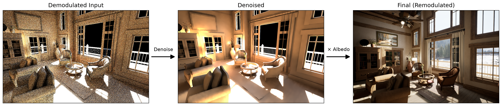
除了albedo texture，还有另外一个提供细节的重要来源，那就是着色法线，比如一面墙壁上凹凸不平的坑洼，或者对人物面部特写时的毛孔，都由着色法线提供。但法线本身并不是一个能简单在降噪前被剥离的量，因为严格来说真正提供凹凸感的是渲染方程中的 $\max(\mathbf{N}\cdot\mathbf{L},\,0)$ 这个项；albedo能被剥离是因为他对于diffuse来说就是常数项，或者说是标量，但是余弦项除了纹理可查的法线之外还有一个radiance的入射方向。也就是说，我们需要一种方式能将入射方向这个信息保留到降噪之后；但同时，入射方向本身又是一个噪声来源，比如像ReSTIR之类的算法每帧都可能选择一个不同的光线入射方向，因此这个入射方向又必须和入射radiance的值一起参与降噪。
到此我们的思路已经很清晰了，我们需要一种数据形式，他能：
- 将radiance的大小和方向编码到一起
- 接受降噪的线性操作
这就引出了我们的主角，球谐函数（Spherical Harmonics）。
# 二、Spherical Harmonics
## 1. 理论
我们先说球面函数，直观点的说法，就是一个单位球面上的每一点都记录着一个值，可以简单表示为 $F(\omega)$，其中 $\omega$ 是球心指向球面上该点的方向。
我们知道，任何一个函数都能通过定义在同一坐标系下的一系列正交基通过不同的线性组合拟合得到。而球谐函数就是这样一组互相正交的基函数，其在笛卡尔坐标系单位球面（$x^2+y^2+z^2=1$）上的表示形式如下：
$$
\begin{aligned}
Y_{0} &=
\begin{cases}
Y_{0}^{0}  &:\frac{1}{2}\sqrt{\frac{1}{\pi}} \\[4pt]
\end{cases}\\
Y_{1} &=
\begin{cases}
Y_{1}^{-1} &:\frac{1}{2}\sqrt{\frac{3}{\pi}}\; y \\
Y_{1}^{0}  &:\frac{1}{2}\sqrt{\frac{3}{\pi}}\; z \\
Y_{1}^{1}  &:\frac{1}{2}\sqrt{\frac{3}{\pi}}\; x \\[4pt]
\end{cases}\\
Y_{2} &=
\begin{cases}
Y_{2}^{-2} &: \frac{1}{2}\sqrt{\frac{15}{\pi}}\; xy \\
Y_{2}^{-1} &: \frac{1}{2}\sqrt{\frac{15}{\pi}}\; yz \\
Y_{2}^{0}  &: \frac{1}{4}\sqrt{\frac{5}{\pi}}\; (3z^2-1) \\
Y_{2}^{1}  &: \frac{1}{2}\sqrt{\frac{15}{\pi}}\; xz \\
Y_{2}^{2}  &: \frac{1}{4}\sqrt{\frac{15}{\pi}}\; (x^2-y^2)
\end{cases}
\end{aligned}
$$

可以将球谐的基函数概括为“常数项 $\cdot$ 多项式项”的通用形式：$Y_n(\omega)=C_{SH_n} \cdot M_n(\omega)$  
任意一个球面函数，就像傅里叶变换一样，同样可以被分解成一系列球谐基函数的线性组合。不同阶数也有不同的几何含义，比如0阶代表球面上的均值；1阶代表一个主方向；二阶代表更精细的方向性。比如左右都有一盏灯，只用一阶的话可能主方向是向上的，而二阶则能让球谐最终的形状在左右各有分布。

注：关于为什么球谐基函数长得这么奇怪：
从多项式的角度，球面函数也是可以通过基础形式的 $x, y, z$ 的多项式作为基函数来逼近的：
- 0次: $1$
- 1次: $x,\, y, \,z$
- 2次: $x^2,\,y^2,\,z^2,\,xy,\,yz,\,xz$
- ...
但是球面上的点应该同时满足 $x^2+y^2+z^2=1$ 这一约束，这意味着2次项组合 $x^2+y^2+z^2$ 就是与第0阶的 $1$ 是重复的，基函数之间不能保证互相正交的要求。因此对于二阶的这三个平方项，我们要做替换，相当于换个基底，使其满足：
- 要与常数1正交
- 替换之后互相还要正交
我们通过调和多项式/拉普拉斯方程，得到满足正交性的一组新基：
$$
\begin{align*}
A=&x^2-y^2\\
B=&2z^2-x^2-y^2 \\
S=&x^2+y^2+z^2
\end{align*}
$$
其中 $S$ 与0阶完全重复，可直接扔掉。$B$ 项又可以通过球面约束直接替换为 $3z^2-1$ 。因此就得到了我们上面展示的球谐基形式，至于前面的常数，就是归一化的系数而已，这里暂不展开。

承接上面的需求，在球面函数语境下，一种更严谨的说法是我们需要一种方式能表示着色点半球范围内的radiance分布，以着色点为球心的正半球中，给定任意一个方向，都应该能查询到该方向的入射radiance；同样是在球面函数的视角，渲染方程的本质其实也是radiance球面函数与余弦核球面函数的内积（inner product），也就是乘积的积分。
我们首先将radiance分布和余弦核表示为球谐函数的形式，通过将原函数投影到球谐基上先得到系数。给定radiance函数与余弦核函数为：$L(w),\,H_n(w)$ ，球谐基函数序列为 $Y$ ，则投影系数同样是该函数与基函数的内积，公式为：
$$
\begin{align*}
 L_{coef}[i] &= \int_{S^2}( L(w)   * Y[i](w) )dw\\
 H_{coef}[i] &= \int_{S^2}( H_n(\omega) * Y[i](\omega) )dw
 \end{align*}
$$
注：虽然这里写的是在整个球面 $S^2$ 积分，但在渲染的语境下，正半球范围内的积分就等于在整个球面的积分。
余弦核的投影系数 $H_{coef}$ 可以解析的计算得出:
$$
H_{coef}(\mathbf{n})=
\begin{aligned}
\begin{cases}
C_{SH_0}  \cdot \pi &\text{// L0}\\
C_{SH_1}  \cdot 2\pi/3 \cdot M_1(\mathbf{n})  &\text{// L1}\\
C_{SH_2}  \cdot \pi/4 \cdot M_2(\mathbf{n})  &\text{// L2}\\
...
\end{cases}
\end{aligned}
$$
其中：
- $\mathbf{n}$ 就是法线
- $M(\mathbf{n})$ 就是将法线 $\mathbf{n}$ 带入前面球谐函数的多项式项
radiance分布 $L(\omega)$ 只能通过离散样本的蒙特卡洛估计，得到：
$$
L_{coef}=
\begin{aligned}
\begin{cases}
C_{SH_0}  \cdot \sum_i\frac{L_i}{N\cdot pdf_i} &\text{// L0}\\
C_{SH_1}  \cdot \sum_i\left(\frac{L_i}{N\cdot pdf_i} \cdot M_1(\omega_i) \right) &\text{// L1}\\
C_{SH_2}  \cdot \sum_i\left(\frac{L_i}{N\cdot pdf_i} \cdot M_2(\omega_i) \right) &\text{// L2}\\
...
\end{cases}
\end{aligned}
$$

进一步的，用这些系数乘上基函数就能拟合出球面函数：
$$
\begin{align*}
 L(w) &\approx \sum_i L_{coef}[i] * Y[i](w) \\
 H_n(w) &\approx \sum_i H_{coef}[i] * Y[i](w)
 \end{align*}
$$
我们前面提到，渲染方程最终的解就等于这两个函数的内积：
$$
\begin{align*}
E&=Integral(L(w)*H_n(w))\\
&= Integral\left(\sum_i L_{coef}[i] * Y[i](w) \quad *\quad \sum_j H_{coef}[j] * Y[j](w) \right)\\
&= \sum_i\sum_j L_{coef}[i] * H_{coef}[j]\quad Integral(Y[i]*Y[j])
\end{align*}
$$
球谐基函数互相正交的性质给我们的积分计算提供了非常大的便利，就因为是正交归一化基，所以：
$$
Integral(Y[i]*Y[j])=\begin{cases}
0\quad i\neq j \\
1\quad i=j
\end{cases}
$$
因此最终能得到：
$$
\begin{align*}
E&=\sum_i L_{coef}[i] * H_{coef}[i]\\
&=dot(L_{coef} ,\, H_{coef})
\end{align*}
$$
再将前面推导出来的系数带入，我们就能得到着色点radiance在球谐空间的计算方式。
## 2. 不足
**精度不足**
尽管球谐函数在理论上能保证拟合出来任意一个球面函数，但实际上开销一般只会限制到前三阶（0，1，2），对于diffuse分量来说，由于余弦核本身是低频函数，能量误差基本能被限制到3%之内；但对于频率更高的specular来说，SH的误差就会比较大，所以一般SH也不会被用到高光分量的表达。
**振铃现象 (Ringing artifacts)**
如前所述，在使用基函数拟合原函数的时候，在函数边缘/极值等变化频率较高的位置附近，容易出现因截断阶数导致的函数值过冲问题，该现象就称为振铃现象 (Ringing artifacts)，也称吉布斯现象 (Gibbs phenomenon)。下图展示了用三角函数拟合方波时在边缘处出现的值偏差过大问题，当我们恰巧采到了图片中箭头所指位置，我们期望的真值是1.0，实际得到的却是一个明显大于1.0的数值：
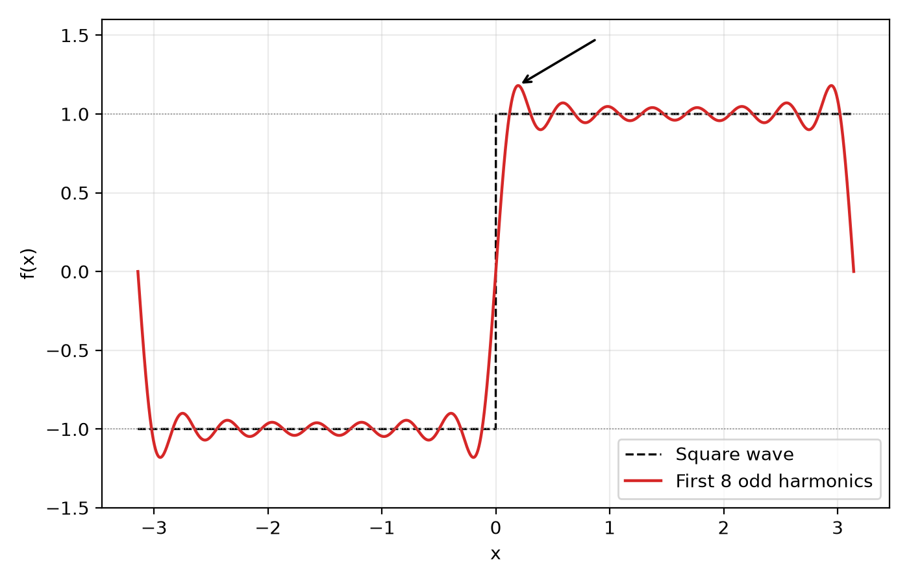
我们可以用一些数值方法进行一定程度上的防治，会在后续具体展开
# 三、Spherical Gaussian
## 1. 理论
因为SH确实存在如我们前面提到的一些局限性，因此在一些近期实现中会使用另一种数据结构替代SH，称之为球形高斯（Spherical Gaussian，以下简称SG）。他和热门技术3DGS中的高斯球体并没有什么关联，3D Gaussian指的是椭球体的几何形状是高斯分布；而Spherical Gaussian更类似于将一个二维高斯函数表示在球面上。
首先，我们所熟知的一维高斯就是一个正态分布函数的形状，这个可以不多展开，二维高斯绘制出来的效果大致类似如下图片：
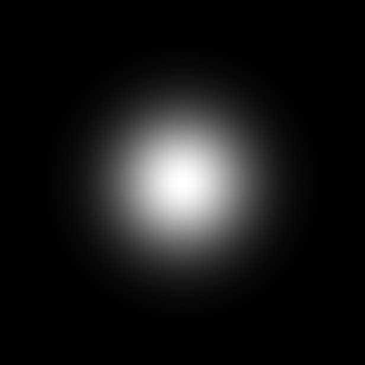

而Spherical Gaussian则类似将这张图包裹到一个球体上，视觉上就像下面这样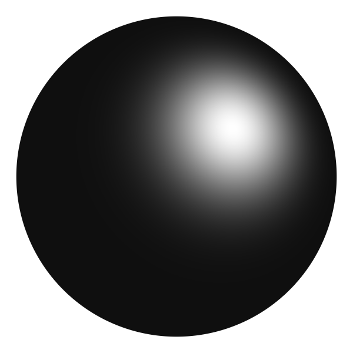
有了这张图片我们便可以从形状上理解为什么SG能够用来表示radiance分布，因为其本身就与着色点处的radiance lobe（波瓣）形状非常相似。
Spherical Gaussian的形式化定义表示为如下公式：
$$
G(v)=a\,e^{\lambda(\mu\cdot v-1)}
$$
其中：
- $a$ ：代表振幅（Amplitude），表示球面上的最大值
- $\lambda$ ：代表sharpness，用来调整波瓣有多宽，球面上的光斑看起来有多大
- $\mu$ ：代表主轴，也就是高斯函数的中心主方向
直观理解，根据输入方向 $v$ 与主轴 $\mu$ 的夹角 $\cos$ 值来决定球面该处函数值有多大。
我们重新看回渲染方程中的两项：$E=\left\langle L, H\right\rangle $ ，思路和SH类似，我们要用SG分别对radiance分布和余弦核进行拟合，下面分别介绍：
**radiance拟合**
基于采样到的radiance样本估计半球范围内的radiance分布，这个问题可以看作是极大似然估计问题（Maximum Likelihood Estimation，也就是基于部分样本估计完整分布）。有多种面向该问题的解法，其中有适用于离线烘焙的高质量估计，也有基于神经网络的online-learning，不过这些不在本文的讨论范围内。我们要用的是面向实时的简单方法：矩匹配。
该方法的流程可以概括为以下几步：
1. 把归一化后的radiance分布视作球面上的概率分布：
	我们知道归一化一个分布的方式是通过将该分布除以他的积分，公式表示为：
	$$
	p(\omega)=L(\omega)/\int L(\omega')d\omega'
	$$
	而这个分布下方向 $\omega$ 的期望 $E_r[\omega]$ 则等于：
	$$
	\begin{align*}
	E_r[\omega]&=\int p(\omega)\cdot\omega \,d\omega\\
	&=\frac{\int L(\omega)\cdot\omega\,d\omega}{\int L(\omega')\,d\omega'}
	\end{align*}
	$$
	拆开来看：
	- 分子就是一阶矩（向量）在球面上的积分，Monte Carlo无偏估计量为 $M_1=L(\omega)\cdot\omega/\text{pdf}$
	- 分母则是单纯的能量（标量）积分：Monte Carlo无偏估计量为 $M_0= L(\omega)/\text{pdf}$ 
2. 用vMF拟合这个分布：
   vMF(von Mises–Fisher)是单位球面上归一化后的高斯分布，公式表示为：
   $$
   \text{vMF}(\omega)=\frac{\lambda}{4\pi\,\text{sinh}(\lambda)}\, e^{\lambda(\text{dot}(\mu_A,\,\omega))}
   $$
   为了用vMF分布拟合前面的radiance分布，只要保证两个分布的期望相等就可以了，只不过目前“方向的期望“毕竟有xyz三个维度，让他们分别相等不太好计算。一方面，我们可以保证两个分布的主方向对齐，也就是 $\mu_A=\text{normalize}(E_r[\omega])$；另一方面，可以把当前的方向自变量换成“方向与中心轴的夹角cosine”这个标量。设 $t=\text{dot}(\mu_A,\,\omega)$ ，vMF分布则表示为：
   $$
    \text{vMF}(t)=\frac{\lambda}{2\,\text{sinh}(\lambda)}\, e^{\lambda t}
   $$
   （分布前面的常数项发生变化主要是为了保证在整个球面上积分为1）
   该分布期望则等于：
   $$
   \begin{align*}
   E_v[t]&=\frac{\lambda}{2\text{sinh}(\lambda)}\int^1_{-1} e^{\lambda t}\cdot t\,dt \\
   &=\text{coth}(\lambda)-1/\lambda
   \end{align*}
   $$
   积分过程我们就在这里省略了。同时我们前面的 $E_r[\omega]$ 也应该转换为：
   $$
   E_r[t]=E[\text{dot}(\omega, \mu_A)]=\text{dot}(E_r[\omega], \text{normalize}(E_r[\omega]))=\text{length}(E_r[\omega])
   $$
   我们后文就将这个值记为 $R$ 。而 $R$ 等于方向期望的长度也不算一个巧合，它的本质类似于分布内所有方向在主轴上投影的加权平均，值的范围也是从0到1。从直觉上也有多种理解这个量的方式，比如他其实某种程度上代表光照的集中程度，接近1时就代表分布接近于方向光；接近0时则接近于均匀光照。
   回到正文，我们只要让 $E_r[t]=E_v[t]$ ，也就是令 $R=\text{coth}(\lambda)-1/\lambda$ ，然后反解 $\lambda$ 即可。我们这里使用Banerjee近似法，获得近似闭式解：$\lambda\approx R\cdot(3-R^2)/(1-R^2)$ 。

至此，一个SG的所有参数我们就都求解完了，直接将对应的部分带回到标准SG公式中即可得到SG拟合的光照分布，形式如下：
$$
\begin{aligned}
L(\omega)&\approx M_0\cdot vMF(\omega)\\
&=\frac{M_0 \lambda}{4\pi\,\text{sinh}(\lambda)}e^{\lambda(\mu_A\cdot\omega)}\\
\end{aligned}
$$
又因为 $\text{sinh}(\lambda)=(e^\lambda-e^{-\lambda})/2$ ，可以进一步变换为：
$$
\begin{aligned}
L_{SG}(\omega)&=\frac{M_0\lambda}{2\pi(e^\lambda-e^{-\lambda})}e^\lambda e^{\lambda(\mu_A\cdot\omega-1)}\\
&=\frac{M_0\lambda}{2\pi(1-e^{-2\lambda})} e^{\lambda(\mu_A\cdot\omega-1)}
\end{aligned}
$$

到这里我们就已经完整梳理完了如何根据采样得到的光照样本拟合一个近似的SG分布。值得一提的是，该方法主要面向光照分布近似于单lobe，且这个lobe还要是各向同性的，这也同样是当前SG的一个局限性，后面会具体展开。

**cos拟合**
余弦核函数的拟合则简单的多，可以直接同样用特殊形状的SG进行近似，当 $\lambda=2.133, a=1.17$ 的时候cosine函数和Gaussian函数形状最为相似：
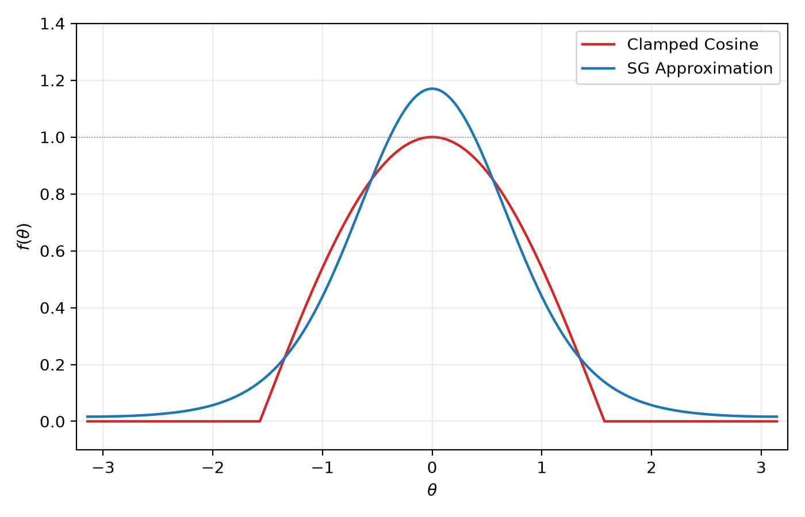
至此，radiance分布和余弦核函数就同样可以分别表示成两个SG函数。我们前面提到，最终的渲染方程的结果其实就是在求这两个函数的内积，而这时就可以利用到两个高斯函数的优秀数学性质：
- 两个高斯函数的乘积还是高斯函数，公式表示为：
$$
G_1(\mathbf{v}, \mu_1,a_1)G_2(\mathbf{v},\mu_2,a_2)=G(\mathbf{v},\frac{\mu_m}{\Vert\mu_m\Vert}, a_1a_2e^{\lambda_m(\Vert\mu_m\Vert-1)})
$$
	其中：
	- $\lambda_m=\lambda_1+\lambda_2$
	- $\mu_m=\frac{\lambda_1\mu_1+\lambda_2\mu_2}{\lambda_m}$
- 高斯函数的积分也是有解析解的，公式表示为：
$$
\int_\Omega G(\mathbf{v})d\mathbf{v}=2\pi\frac{a}{\lambda}
(1-e^{-2\lambda})$$

合在一起，两个SG的内积公式为：
$$
\left\langle G_1,G_2\right\rangle =2\pi a_1a_2\frac{e^{D-\lambda_1-\lambda_2}(1-e^{-2D})}{D}\quad D=\Vert\lambda_1\mu_1+\lambda_2\mu_2\Vert
$$
通过这些性质，我们就能近似的计算出SG表示形式下渲染方程的解


## 2. 优势与不足
**正确性与实际效果**
虽然SG和SH的表现形式类似，但SG和SH的本质可以说并没有什么关系。SH本身是一组基函数，如果我们只讨论纯理论层面，任何一个球面函数都可以用这组基函数的线性组合表示，甚至包括SG，同样给定渲染方程中的“radiance分布” $L(w)$ 和 “余弦核” $H(w)$ 的球面函数，两者在SH基下都有绝对正确表达形式，只要阶数够，SH能保证收敛到精确值；但SG更像是用一个长得像的函数替代了原函数，没有这种精确度随空间开销上升的保证。
当然这种抛开实际谈理论的说法确实也很流氓。给到等同于一阶SH的空间预算，SG的效果确实更加接近真实效果，下图是用一阶/二阶SH以及SG去拟合余弦核函数的对比图：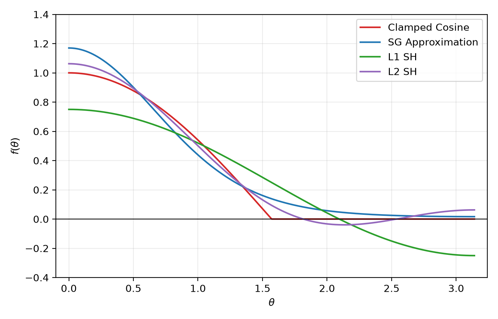
能看出在低阶表现上SG确实优于SH不少，我们之后的渲染结果也能证实这点。

**多波瓣拓展**
我们前面提到，当用SG去拟合光照分布的时候，一个重要假设是光照分布近似于正态分布。这在“有一个主要光源影响该着色点”的时候是一个合理的假设，单光源形成的单波瓣（lobe）与SG的形状非常类似。但如果不满足这一重要前提，比如着色点的左上方和右上方有两个亮度相同的光源，在单SG的情况下可能会直接视作正上方有一盏灯（虽然可能从最终渲染结果上来看反倒还没什么差别）。
然而，这相对来说可能还是SG的一个优势，如果遇到了两个波瓣的情况，SG方法可以用二倍于之前的开销就能解决这一问题；SH的开销则是平方级别的增长，一阶共4个系数，二阶共9个系数，给到三阶就是16个系数了。相同开销增长速度下，SG的理论收敛速度可能会更好。这意味着在substrate材质（多BRDF类型的材质）情况下，不同的材质层需要对应不同lobe形状时，SG可能是更好的支持方案。

**specular支持**
我们前面对SH和SG应用范围都局限于diffuse情况下，但对于SG，我们可以将讨论扩展到specular材质上。SG的lobe宽度本身就有一个天然的sharpness $\lambda$ 参数来控制，也就是说需要SH提升阶数才能拟合的低粗糙度材质尖锐lobe，反倒是SG的舒适区（一个反直觉的点在于SG反倒会在大粗糙度的情况下误差更大）。
specular 材质的 BRDF 并不是常数，因此并不能提到积分外面，我们展开其渲染方程为：
$$
\begin{align*}
L_o(\omega_o) &= \int_{\Omega} f_r(\omega_i, \omega_o)\, L_i(\omega_i)\, \max(\mathbf{n} \cdot \omega_i,\, 0)\, d\omega_i \\
&= \int_{\Omega} \frac{F(\omega_i,\omega_o)D(\omega_i,\omega_o, \mathbf{n})G(\omega_i,\omega_o, \mathbf{n})}{4|\mathbf{n} \cdot \omega_i|\,|\mathbf{n} \cdot \omega_o|}L_i(\omega_i)\, |\mathbf{n} \cdot \omega_i|\, d\omega_i\\
&= \int_{\Omega} \frac{F(\omega_i,\omega_o)G(\omega_i,\omega_o, \mathbf{n})}{4|\mathbf{n} \cdot \omega_o|}D(\omega_i,\omega_o, \mathbf{n})L_i(\omega_i)\, d\omega_i
\end{align*}
$$
其中BRDF中的FDG三项在特定参数下的二维函数切片形状如下：
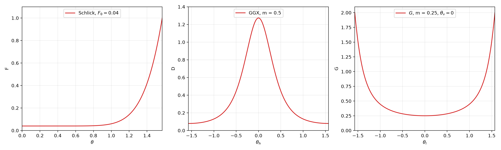
就像之前diffuse的思路，我们同样希望能将积分中的这几项表示为球面函数，并用SG进行拟合。但是看上面的函数形状，很明显只有D项GGX分布的形状和高斯比较类似。（这里笔者就想吐槽一下了，明明GGX分布就是为了替代之前基于高斯的Beckmann分布，这里为了近似居然又把高斯拉回来了，那GGX独特的“拖尾感”不是又没了。）
对于D项，经实验得出可通过如下形式的SG参数近似：
$$
D(\mathbf{h})\approx G(\mathbf{v},\mu,\lambda,a)=G(\mathbf{h},\mathbf{n}, \frac{2}{m^2},\frac{1}{\pi m^2})
$$
其中：
- $\mathbf{h}$ ：是半程向量，等于$\frac{\omega_i+\omega_o}{\Vert\omega_i+\omega_o\Vert}$
- $m$：是粗糙度roughness的平方
在给定 $m=0.5$ 的时候拟合效果如下:
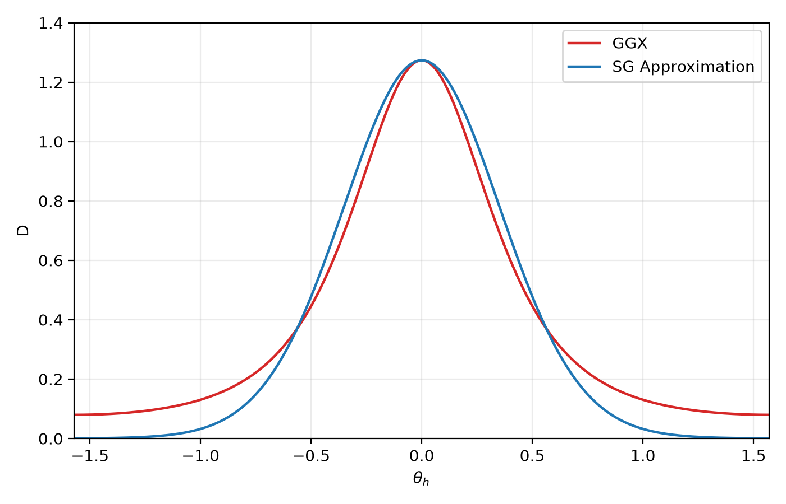
而对于剩余的几项，我们只能近似地将他们当作常数项提到积分外面。严格来说能被近似成SG的入射radiance分布很有可能是通过多个方向采样不同值获得的，但G项和F项的计算依赖于一个给定的光线入射方向，所以这里的近似采用的思路是将SG的主轴方向，也就是 $\mu$ 当作唯一的光线入射方向，锚定下来了入射方向和出射方向，G和F的值也就是确定的常数。公式表现为如下形式：
$$
\begin{align*}
L_o(\omega_o) &= \int_{\Omega} \frac{F(\omega_i,\omega_o)G(\omega_i,\omega_o, \mathbf{n})}{4|\mathbf{n} \cdot \omega_o|}D(\omega_i,\omega_o, \mathbf{n})L_i(\omega_i)\, d\omega_i \\
&=\frac{F(\mu,\omega_o)G(\mu,\omega_o,\mathbf{n})}{4|\mathbf{n} \cdot \omega_o|}\left\langle G_D(\mu, \omega_o, \mathbf{n}), \, G_L(\mu)\right\rangle 
\end{align*}
$$
其中：
- $G_D, \, G_L$ 分别是GGX分布函数和radiance分布的SG近似
- $\left\langle G_D, \, G_L\right\rangle $ 则是两者的内积
注：关于 $|\mathbf{n}\cdot\omega_i|$ 的约分：从渲染方程的角度来说，他能直接被BRDF的分母约掉，但是我们SG形式下的计算也是近似，所以这里也可以选择让SG近似的余弦核先参与内积，然后再除。

# 四、实践
## 1. Common
### a. 关于编码
回到我们面向的问题，我们想解决的其实是如何让radiance在降噪之后还能保留其方向性。降噪是线性操作，对于本身就用正交基表示的SH来说是没关系的；但是SG并不是什么线性基，我们不能对SG的 $\mu$ 和 $\lambda$ 参数直接进行滤波/插值之类的操作。
尽管如此，我们回看SG完整的拟合过程：将入射radiance的矩做加权平均 -> 用矩匹配反向拟合出radiance的近似SG分布 -> 和同样是SG近似的余弦核（或者BRDF）内积。我们发现SG的前身——入射radiance的矩，是完美的线性量；而在SH这边，我们把前三阶基函数的多项式项拿到这里：
$$
\begin{align*}
&1,\\
&x,\,y,\,z,\\
&xy,\,yz,\,xz,3z^2-1,\,x^2-y^2
\end{align*}
$$
会发现他同样也是矩的形式。因此相比之前“先将radiance编码成SH/SG，经过降噪，再计算其与余弦核的内积”的过程；一种更工程化的想法则是：先将radiance编码成矩， 经过降噪，将矩重建成SH/SG，然后与对应形式的余弦核内积。对于后一种思路，SG和SH可以被看成是一种完全独立的resolve方式，前序GI算法和降噪器都不需要知道我们用的是SH还是SG，SG/SH只会在最后resolve阶段作为一种decode方式自由选择（不过目前SG算法用不到SH表示下的二阶矩）。
### b. 关于开销
我们的确需要用额外的纹理去存radiance的矩，但究竟用几张纹理还是有很大的可伸缩性的。
最朴素的想法中，我们对Radiance的RGB三个通道都维护一套矩：
- 0阶就是1个标量，
- 1阶矩有 xyz 3个系数，单色彩通道就是一张RGB_Float纹理；全RGB通道就是3张纹理
- 2阶每通道都有5个系数，并上1阶共8个系数，单个色彩通道共占2张RGBA_Float；全RGB通道就是6张纹理
我们原本就有一张要输到降噪器中的radiance纹理，如果我们把它改存不乘cos的0阶的RGB标量，那就相当于我们为了支持1/2阶球谐，要“额外”分配3/6张纹理。听起来是相当离谱的开销，不过我们好在有多种优化思路：
**亮度通道**：其实很多情况下我们并没有必要存RGB三个通道，我们可以只维护一个亮度通道，比如存luminance，在降噪之后对完整的三个通道等比缩放。这样1/2阶球谐就只需要多分配1/2张纹理，开销直接是之前的1/3。当然，便宜不能白占，单亮度通道不出现大偏差的前提是着色点的光照分布不与方向明显相关；简单来说，如果着色点左边是一个红灯，右面是一个蓝灯，那这种方法会出现明显的色偏。原生NRD就实现了这么一种单通道的细节增强策略，属于是集成方便，但细节复原程度确实有限的启发式trick，我们在后面详细展开。
**色彩空间**：切换色彩空间本质也是线性操作，因此在相同开销下，质量和RGB空间可能并没有什么区别。但不同色彩空间的优势在于我们能为不同的通道分配不同的精度和开销。比如我们这里用的YCoCg空间，也就是亮度（Y）- 色度（CoCg）空间。在光照分布空间，亮度的变化频率往往会高于色度，直观上来看亮度上的误差往往也是最明显的。因此我们可以在YCoCg空间下只对亮度通道Y维护二阶矩，CoCg都只用一阶，这样1/2阶球谐就需要多分配3/4张纹理，我们以一个更低的开销支持了二阶球谐。当然，不同通道位精度上的调整也可以基于此，这里就不具体展开了。

基于以上方法，我们可以基本整理出来一套矩存储的纹理开销方案：使用YCoCg空间，一共支持四种纹理分配策略：

- Y1：单亮度通道（存luminance还是Y分量都行），开销一张纹理
- Y1Y2：二阶单亮度通道，开销两张纹理
- Y1CoCg：全色彩三通道，开销三张纹理
- Y1Y2CoCg：全色彩三通道+二阶单亮度通道，开销四张纹理
我们可以在质量与开销的平衡中自由选择。

SH类的基本成员和编码方式放到下面：
```cpp
struct FSphericalHarmonics
{
	float3 Y1;		// x, y, z
	float Y2[5];	// xy, yz, 3z^2 - 1, xz, x^2 - y^2

	float3 Co;		// x, y, z
	float3 Cg;		// x, y, z

	void Encode(float3 Radiance, float3 Dir)
	{
		const float3 R = RGB2YCoCg(Radiance);
	
		Y1 += R.x * Dir;
		Y2[0] += R.x * (Dir.x * Dir.y);
		Y2[1] += R.x * (Dir.y * Dir.z);
		Y2[2] += R.x * (3.0f * Dir.z * Dir.z - 1.0f);
		Y2[3] += R.x * (Dir.x * Dir.z);
		Y2[4] += R.x * (Dir.x * Dir.x - Dir.y * Dir.y);
	
		Co += R.y * Dir;
		Cg += R.z * Dir;
	
	}
};
```
注：
- 这里的`FSphericalHarmonics`并不只是球谐，因为能看到实际类的成员变量是以矩的形式存储的，和球谐没什么必然联系
- 从内存对齐的角度可能换成四个float4成员更好，这里是为了方便理解
- 能注意到我们并没有存第0阶的参数，按照我们之前的设计，原本整个计算流程就应该有一个标量通路/纹理，并不需要额外的开销。只不过这种设计下原标量通路可能含义就不再相同了，比如是未乘过cos/BRDF的radiance值。

到此，我们的管线可以基本梳理为：
- 将radiance样本编码得到矩
- 输入到降噪管线中，
- 将降噪后的矩resolve得到最终结果
resolve方式可以自由选择SG方式或者SH方式、一阶或者二阶、单通道或者三通道。

### c. 关于细节恢复强度调整
笔者实现这一套系统最开始面向的是“皮肤细节在降噪之后变得平滑”这一问题。前序皮肤算法中有SSS的近似处理，简单来说：真实的皮肤模型应该是光线打到皮肤上某一点，在皮肤表面下随机游走，最后从着色点处窜出来，这就提供了皮肤的温润感；SSS为了近似这一过程，在以着色点为中心的泊松圆盘上随机采样几个周围点，将这些点的入射光照乘上对应的diffusion profile(可以理解为模拟光线在皮肤下游走后的能量衰减系数)后加权平均得到着色点的结果。用公式表示大致为：
$$
L_o(x_o, \omega_o) = \sum_i R(|x_o - x_i|) \cdot L(x_i) \cdot\cos(n_i, \omega_i)
$$
也就是说，在标准的BSSRDF中，一般使用的都是周边采样点的法线。尽管从能量级别上看，无论用着色点的法线还是采样点的法线都相当于乘了一个cosine，但如果直接使用着色点的法线，会导致细节过于突出，皮肤呈现干涩感、塑料感。而在我们的SH建模中，尽管我们确实可以把这些周围样本点的radiance都编码成矩，但在resolve的时候只能有唯一一个法线，因此就会出现上面这种“细节恢复效果太好了”这种情况。
对于这个问题，AI给出的建议类似于对球谐信号进行滤波，过滤掉尖锐分量；但实测下来会有比较明显的能量损失（也就是偏暗）。
笔者采用的方式比较取巧：我们知道着色法线是变化频率较大的、用来提供细节的，但是几何法线是相对比较平滑的，因此这里先把着色法线和几何法线做一个线性插值，然后再用来resolve：
$$
\begin{align*}
L_o(x_o,\omega_o)&=C\cdot\left\langle L_i(x_i), \, \cos(n_l, \omega_i)\right\rangle \\
n_l&=\text{normalize}(\text{lerp}(n_{s},\,n_g, \,\alpha ))
\end{align*}
$$
而这个线性插值用到的系数 $\alpha$， 就可以给到美术同学用来控制细节恢复强度。
## 2. About SH
### a. Artifact 防治
我们前面提到，SH的表示本身可能会导致振铃现象。从本质上说，这是因为SH的阶数截断导致的，我们可以理解为SH的每一阶在投影的时候都贡献了一定程度上的能量（这个贡献可正可负），无限阶累加的时候能量则会保证收敛到正确值。一个尖锐信号的能量往往主要分布在高阶贡献；而一个均匀变化的信号能量则主要分布在低阶。
在SH当作GI系统的Probe时，振铃可能导致大范围光照artifact，视觉上非常明显；但在我们的用法中：
1. 一方面是每个像素一个球谐，这种情况的振铃影响一般局限于单个像素
2. 另一方面，结合上述提到的信号尖锐程度与能量分布的关系，我们在把SH用作GI系统diffuse分量表达的时候，振铃的出现也比较少见（严格来说光照分布的拟合是否出现振铃，只与光源本身的集中程度有关，GI系统面向的往往是面积光源、间接光、天光这种贡献，变化频率相对较低）
因此视觉效果很可能就只是出现概率较低的Salt-and-Pepper noise。
但是，振铃真正出现的时机是在最后的内积计算，也就是resolve阶段。也就是说，就算当作噪声，也是先降噪，后出现振铃，因此我们最好在降噪前就进行防治。
与此同时，因为球谐（矩）本身的方向性允许出现负值，一个笔者在开发过程中发现的更严重的问题是“萤火虫 $\times$ 负值”的情况，常规的萤火虫尚且可以用降噪器直接处理（Relax 降噪器中也有专门的anti-firefly pass），但一个极大正值乘上负数就会造成在该像素留下一个极大负值；进一步的，降噪器的spatial filter会把这个极大的负值扩散开，resolve的时候就会形成大块黑斑。我们又不能仅通过值的正负就clamp（如前所述，矩的表达允许出现负值）。

因此我们要在降噪前的编码阶段就进行异常值剔除，思路用伪代码表示如下：
```text
ClampOutlier(Moments, DC):
    // 0. 非法值（NaN / Inf）直接置零
    for each coefficient c in Moments:
        if not isfinite(c): c = 0

    // 以 0 阶（DC，通常是 radiance / pdf）作为“正常能量”的参考
    Reference = max(DC, 0)

    // 1. 一阶：估计 L1 系数在 resolve 时最多能贡献多少能量
    //    超出 DC 的一定倍数时，整体等比缩放（各色彩通道取最严格的缩放）
    Need1   = EstimateL1Energy(Moments.L1)
    Budget1 = MaxRatioL1 * Reference
    if Need1 > Budget1:
        Moments.L1 *= Budget1 / Need1

    // 2. 二阶：同理，只对亮度通道的 L2 系数做等比缩放
    Need2   = EstimateL2Energy(Moments.L2)
    Budget2 = MaxRatioL2 * Luminance(Reference)
    if Need2 > Budget2:
        Moments.L2 *= Budget2 / Need2
```
简单理解，就是对一、二阶系数可能投影出的能量分别做倍数clamp：以0阶的DC值作为正常能量参考，高阶系数允许的能量不能超过它的若干倍，超过就整体等比缩放。等比缩放只改变幅度、不改变方向，所以不会破坏矩本身允许出现的正常负值，同时又能压住“萤火虫 $\times$ 负值”造成的极大负值。至于两个倍数阈值，可以按场景调参。当然，如果是因为pdf本身较小造成的萤火虫，那同样也是前序光追算法中的老问题，我们不在这里展开讨论。
## 3. About SG
### a. SG积分近似
我们前面提到的SG拟合思路是将光照分布和余弦核分别拟合成SG，然后基于SG自身的内积公式计算结果。但是SG拟合出来的余弦核在夹角大于90度的时候并不能截断，而是长拖尾；同时最大值也大于1，这样会使积分计算出来的结果误差较大。工程中往往会使用Stephen Hill的数值近似法。
该方法不是单独用来近似余弦核，而是用来近似“与余弦核求内积”这个过程，公式如下
$$
\begin{aligned}
% Scale 与 Bias
s(\lambda) &= 1 + 2e^{-2\lambda} - \frac{1}{\lambda}, \\
b(\lambda) &= \frac{e^{-\lambda} - e^{-2\lambda}}{\lambda} - e^{-2\lambda}\\
% 过渡宽度与拟合常数
x &= \sqrt{1 - s}, \qquad c_0 = 0.36, \qquad c_1 = \frac{1}{4c_0}\\\\
% 中间二次过渡，两端用 saturate
y(\mu_n) &=
\begin{cases}
\dfrac{(c_0\,\mu_n + c_1\,x)^2}{x}, & |c_0\,\mu_n| \le c_1\,x \\[2ex]
\operatorname{saturate}(\mu_n), & \text{otherwise}
\end{cases}\\\\
% 最终辐照度
E(n) &\approx \frac{2\pi a}{\lambda}\,\big(s\,y + b\big)
= M_0\,\frac{\max(s\,y + b,\,0)}{1 - e^{-2\lambda}}
\end{aligned}
$$
其中：
- $\lambda$ 就是我们近似出来的光照分布的sharpness
- $\mu_n$ 则是光照分布中心轴与法线的夹角余弦值
该方法在几个不同 $\lambda$ 下的拟合效果如下：
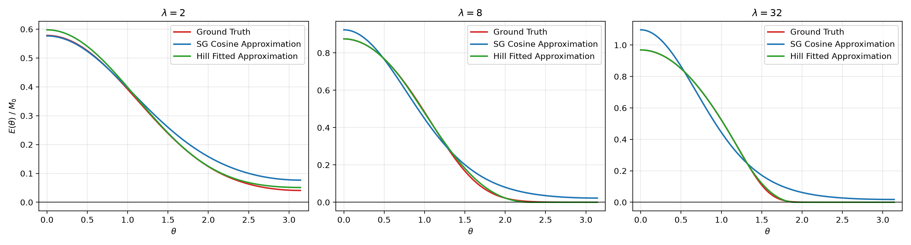
### b. NRD SG Trick
在正常SG/SH的约定中，被编码成矩的应该是没有乘过cosine的radiance，也就是 $L/pdf$ ，这样我们就被迫要在前序算法中把cosine拆出来，涉及到原有管线的改动。而在NRD原本的实现中，也支持这样一种基于SG的细节增强技巧，只需要单通道（亮度通道），并且不对原有管线做任何侵入式更改（radiance仍旧是 $L\cdot\cos/pdf$ 的含义），尽管细节增强效果有限，但是集成方便并且开销较小。
NRD的做法很暴力：类似于直接再乘一遍余弦，然后为了用特殊情况对齐峰值，强行把值放大回来。
第一步近似就是把光照分布重建回来：
对于一个标准SG $G(\omega)=Ae^{\lambda(\mu\cdot\omega-1)}$，其在球面的积分结果等于：
$$
C_0=\int_{S^2}G(\omega)d\omega=2\pi A\cdot\frac{1-e^{-2\lambda}}{\lambda}
$$
因此，对于一个已经计算出来的光照积分结果，我们可以反解其振幅：
$$
A=\frac{C_0\cdot\lambda}{2\pi(1-e^{-2\lambda})}\approx\frac{C_0\cdot\lambda}{2\pi}
$$
在计算中$(1-e^{-2\lambda})$ 接近1，可以近似省略。
而$\lambda$，直接假设等于2，这样一个近似光照分布就有了，但是当前分布硬要说的话也是乘过cosine的，也就是 $L(\omega)\cdot H(\mathbf{n}, \omega)$ 。
在此基础上，我们让这个分布再与余弦核做一次内积，这很明显是能量不守恒的，因此我们用一个常数强行对齐“在光照方向平行于法线方向”时的着色值，剩余方向都用这个常数直接缩放。下图是该方法的拟合效果：
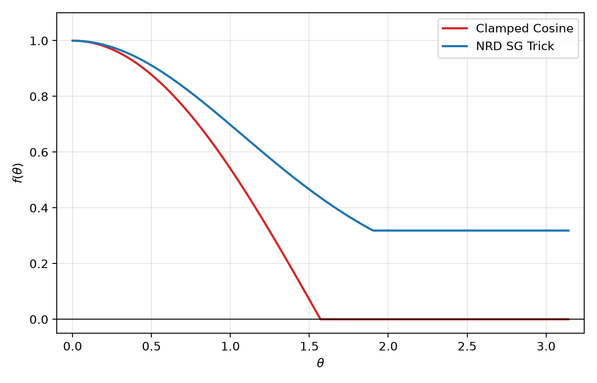
尽管效果确实有限，但胜在集成方便。
## 4. 效果比对
我们下面会展示不同策略下的细节恢复效果比对：
*Original vs. L1 SH vs. L2 SH*

|     Original      |     L1 SH     |     L2 SH     |
| :---------------: | :-----------: | :-----------: |
| 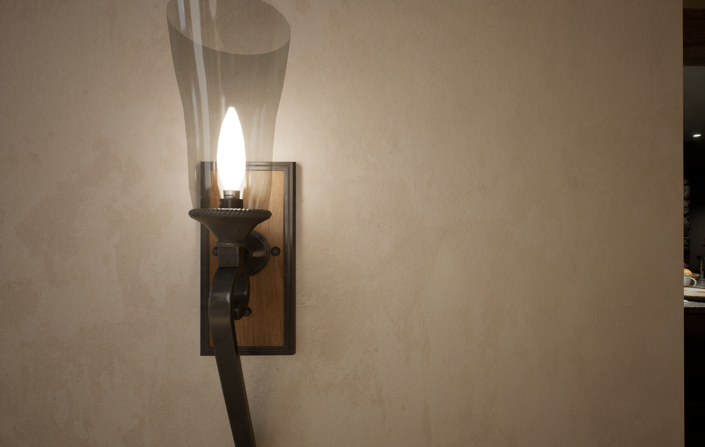 | 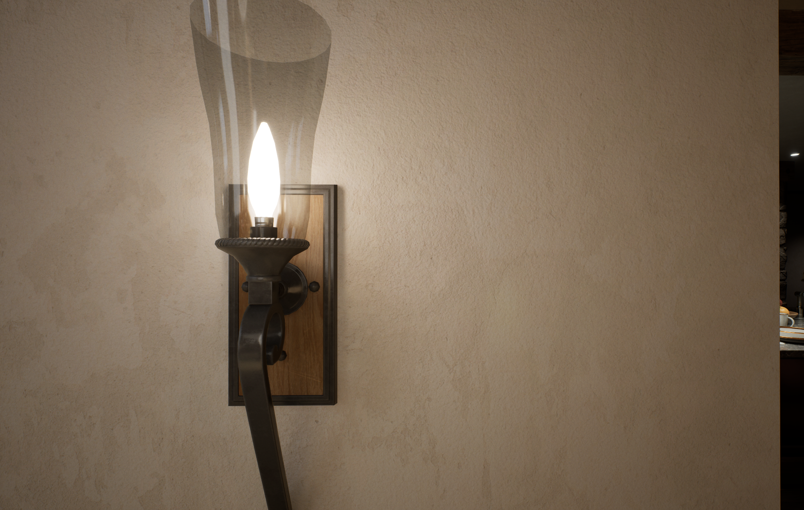 |  |

*L1 SH vs. SG*

|     L1 SH     |     SG      |
| :-----------: | :---------: |
|  | 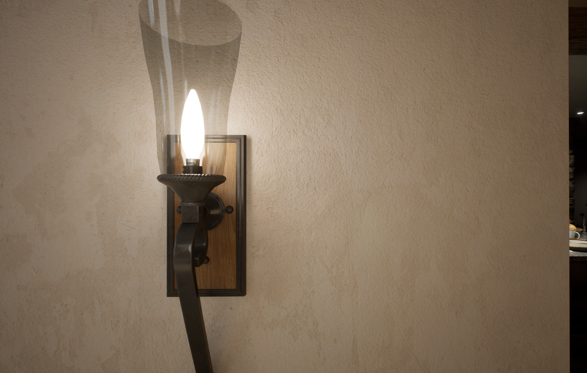 |

在相同开销的前提下，SG的效果更好

|     Original      |     NRD SG     |     L1 SH     |
| :---------------: | :------------: | :-----------: |
|  | 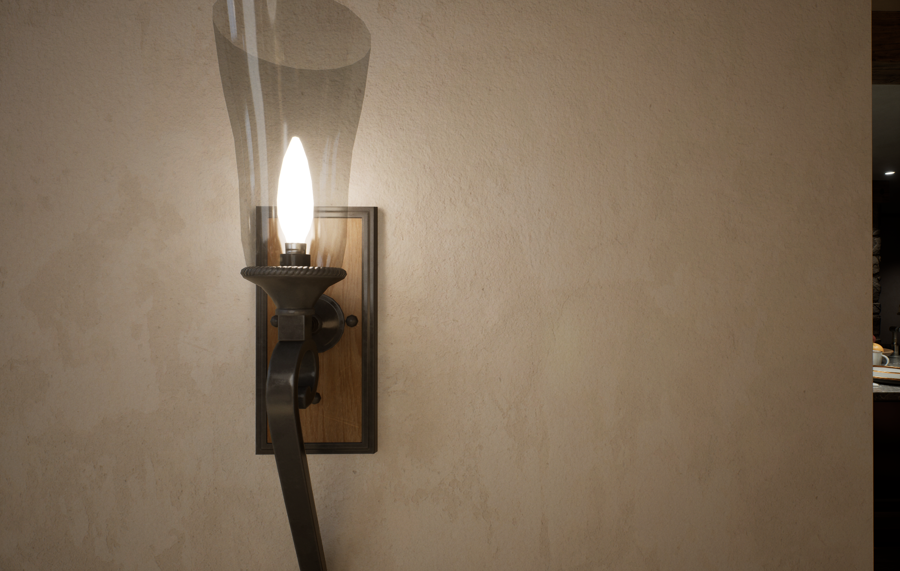 |  |

NRD的SG trick确实没有SH/SG的细节效果好，但相比Original仍然有一定效果。

# 参考

1. Matt Pettineo (MJP). [SG Series Part 3: Diffuse Lighting From an SG Light Source](https://therealmjp.github.io/posts/sg-series-part-3-diffuse-lighting-from-an-sg-light-source/)
2. Matt Pettineo (MJP). [SG Series Part 4: Specular Lighting From an SG Light Source](https://therealmjp.github.io/posts/sg-series-part-4-specular-lighting-from-an-sg-light-source/)
3. NVIDIA. [NVIDIA Real-time Denoisers (NRD)](https://github.com/NVIDIA-RTX/NRD)
