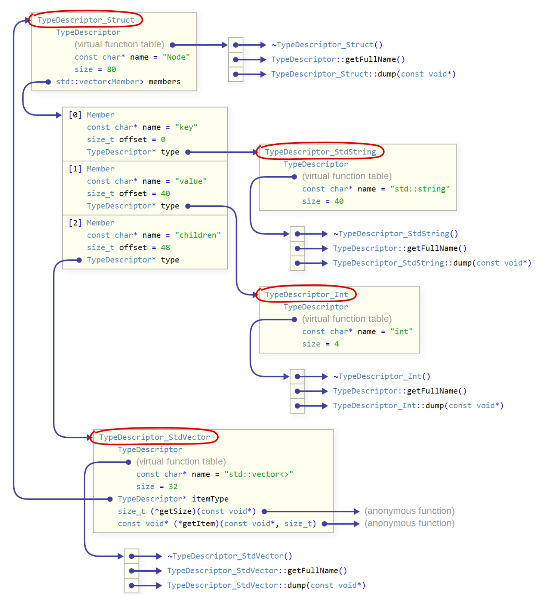
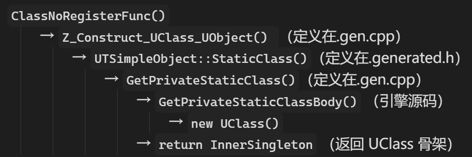

反射（Reflection）对游戏引擎是一种非常重要的功能，在常见商用引擎中，Unity依赖于底层的C#可以直接实现运行时反射；但UE底层的C++本身是静态编译型语言，并不支持原生支持反射，因此UE开发出了两套系统以支持反射：Unreal Property System & Unreal Header Tool。

本文在接下来的内容中会从最基础的反射概念以及实现开始介绍，逐步从基础模型过渡到UE的工业实现，看看UE为了“看清楚自己“做了哪些事情。

# Reflection

## 1. Definition

”反射“这个词学术上的定义是”一个程序检查（introspect）或修改（intercede）自身结构和行为的能力“。严格来说反射的能力也分三六九等：

- **Introspection**（自查）：对自身的信息进行只读的查询，比如查询一个类有哪些成员，基本所有“宣称”支持反射的语言最起码都支持这个最基本的能力。
- **Structural Reflection**（结构反射）：能够对程序的内容进行运行时写入，例如为一个类注册新成员，新方法等。这种能力本质说明对象的排布是一个可增删条目的字典（dict），到这里Java和C#就只能部分支持了
- **Behavioral Reflection**（行为反射）：能对语言调用规则做动态修改，比如拦截方法调用、拦截字段访问等。这属于反射的终极形态，代表性的支持语言就类似python，以及纯面向对象语言smalltalk这种。

我们为什么在游戏引擎中需要反射呢？比如我们需要在Editor中动态调整某一个对象的某一个属性，那我们起码要让程序知道这一堆字节哪部分都代表什么含义；又或者我们想确定一个类是否存在一个叫”HealthValue“的属性。这些游戏中常见的功能都需要反射的支持。

但即使简单如第一层，原生C++也不支持（C++26目前已经支持静态反射了）。这个一定程度上由于C++的”零开销原则“——不为用不到的功能付出开销。Java/C#原生支持反射是因为他们的运行基于虚拟机，程序信息本身就以字节码的形式存着，反射只是将他们暴露了出来；但C++程序的编译结果不存着这些信息，如果详查就要用多余的空间去维护，用不到的时候反而浪费。

再者，其实C++原生支持“阉割”版的反射信息，也就是RTTI（Run-Time Type Information），该信息往往根据编译器实现，会被记录在虚函数表（vtable）的负偏移处，但信息很有限，一般也就是typeid之类用于简单比较的信息，不足以满足反射的完整信息查询需求。

不过开发者们已经有了一套成熟的C++反射实现方式了，我们下面以一个比较基础的实现来理解一下反射的核心实现方式。

## 2. Basic Implementation

我们这里参考的是这篇文章[A Flexible Reflection System in C++](https://preshing.com/20180116/a-primitive-reflection-system-in-cpp-part-1)的实现，这位大佬实现了一套非常简明的C++反射支持，感兴趣的同志可以直接读原文。

我们现在有一个简单结构体Node定义如下：

```c++
struct Node {
    std::string key;
    int value;
    std::vector<Node> children;
};
```

我们想在运行时实现类似下面这样的操作：

```C++
std::string key = node.GetByName("key");
```

也就是通过名字获取成员。为了实现类似这种的反射功能，我们需要知道这个类有哪些成员、名字都是什么、类型都是什么。

因此我们首先需要一种描述成员类型的数据结构，我们定义`TypeDescriptor`形式如下：

```cpp
struct TypeDescriptor {
    const char* name; // 这里的name是类型名称，例如“int”,"std::vector"等
    size_t size;

    TypeDescriptor(const char* name, size_t size) : name{name}, size{size} {}
    virtual ~TypeDescriptor() {}
    virtual std::string getFullName() const { return name; }
    virtual void dump(const void* obj, int indentLevel = 0) const = 0;  
    // 这里的dump函数是通用的节点属性操作函数，可以被重写成任意功能，例如打印、查询...
};
```

能观察到他的主要成员属性就两个：类型名称和尺寸，作为基类的`TypeDescriptor`并不会根据类型区分具体行为和成员，而是会基于继承体系做根据类型的派生。比如为了支持上面`Node`类型的反射，我们可以派生出`TypeDescriptor_String`、`TypeDescriptor_Int`、`TypeDescriptor_StdVector`以及结构体自身的`TypeDescriptor_Struct`。我们在这里简单给出`TypeDescriptor_Struct`的定义作为示例：

```cpp
struct TypeDescriptor_Struct : TypeDescriptor {
    struct Member {
        const char* name;
        size_t offset;
        TypeDescriptor* type;
    };  // 单个成员的描述符封装

    std::vector<Member> members;  // 描述有哪些成员

    TypeDescriptor_Struct(void (*init)(TypeDescriptor_Struct*)) : TypeDescriptor{nullptr, 0} {
        init(this);
    } // 接收一个静态函数指针（初始化函数），然后直接调用，做初始化
    // 这里选择这种“不太直接的”初始化方式是因为宏展开比较好写（否则下面注册成员的时候每次都要给宏传一个类名Node），不需要特殊注意
    
    // ...                                                              };
```


有了类型描述符，我们就可以build Node类的反射信息，首先我们要明确的是C++的类型反射元数据的构建在编译期就能完成，因为所有的程序信息（比如类的成员，函数参数等）本质上都是lookup-table，在编译时就可以确定的，这与反射本身是动态操作不矛盾。

我们定义一个宏`REFLECT()`，将其注册到原本Node结构体中：

```c++
struct Node {
    std::string key;
    int value;
    std::vector<Node> children;
    
    REFLECT();
};
```

这个宏的作用就是为结构体添加静态属性或方法，该宏展开结果如下：

```c++
static reflect::TypeDescriptor_Struct Reflection; 
static void initReflection(reflect::TypeDescriptor_Struct*);
```

分别是类本身的TypeDescriptor与对应的初始化函数声明。该声明的实际展开会在源文件中定义：

```cpp
REFLECT_STRUCT_BEGIN(Node)
REFLECT_STRUCT_MEMBER(key)
REFLECT_STRUCT_MEMBER(value)
REFLECT_STRUCT_MEMBER(children)
REFLECT_STRUCT_END()
```

从语义上能分析的出来，这些宏就是分别对结构体的各个成员进行信息注册，而这些宏的展开就是上面`initReflection(...)`函数的定义：

```cpp
// Definition of the struct's type descriptor:
reflect::TypeDescriptor_Struct Node::Reflection{Node::initReflection};

// Definition of the function that initializes it:
void Node::initReflection(reflect::TypeDescriptor_Struct* typeDesc) {
    using T = Node;
    typeDesc->name = "Node";
    typeDesc->size = sizeof(T);
    typeDesc->members = {
        {"key", offsetof(T, key), reflect::TypeResolver<decltype(T::key)>::get()},
        {"value", offsetof(T, value), reflect::TypeResolver<decltype(T::value)>::get()},
        {"children", offsetof(T, children), reflect::TypeResolver<decltype(T::children)>::get()},
    };
}
```

这里的TypeResolver是一种类型解析器，也就是返回一种给定类型的`TypeDescriptor`派生类对象（`TypeDescriptor*`类型），该类的具体实现涉及到C++的SFINAE机制，这里不详细展开。

下面是Node的反射信息内存布局，可以作为参考：



至此，我们基本了解了如何用C++实现一套基础的类型反射支持。我们大致总结一下为了支持反射需要做些什么：

- 用继承体系提供一套通用的类型描述符
- 为想要支持反射的类提供一套注射与解析宏
- 提供一套统一接口的反射信息处理方式（这里的dump以及静态成员Reflection就是，但是我们没有详细展开，因为实现因需求而异）

那么下面我们就要来看UE是怎么实现这套机制的了。

# Unreal Property System

## 1. Inheritance Hierarchy

UE支持反射的系统称为Unreal Property System，和最基础的反射系统一样，该系统也需要一套“TypeDescriptor”，UE定义这套类型继承体系的基类为`UField`，它直接继承自UE引擎所有类的基类`UObject`，`UField`的派生体系如下：

- UField:
  - UStruct:
    - UClass (C++ Class)
    - UScriptStruct  (C++ Struct)
    - UFunction (C++ function)
  - UEnum (C++ enum)
  - UProperty
    - UBoolProperty (C++ bool)
    - UIntProperty (C++ int)
    - ...

我们可以理解UClass就是为了描述一个类（Class）的结构信息而存在的类型，其余也是如此。

在上面这个继承关系中，每个括号当中标的是该“TypeDescriptor”对应的C++原生类型，容易有歧义的就是直接继承自`UField`的这个`UStruct`，他并不对应任何C++原生类型，真正对应C++ Struct的是他派生出来的`UScriptStruct`

*注：C++语言本身规定Class和Struct并无用法上的差别，但是通常概念上规定Class才是有方法有成员的“类“，Struct是简单的数据集合体。UE这里采用的就是这种区分方式*

上述继承体系已经在UE5中做出了调整，引擎把种类数量庞大的`UProperty`单独迁出来了一个分支，不再继承自`UObject`，这是因为UObject太重了，UObject所支持的接口和属性很多在Property中都用不到（比如GC生命周期管理），因此将`UProperty`独立成了`FProperty`（UE当中F开头的类型代表是结构体）。因此现在的体系是这样的：

- UField:
  - UStruct:
    - UClass
    - UScriptStruct
    - UFunction
  - UEnum
- FField:
  - FProperty：
    - FBoolProperty
    - FIntProperty
    - FStructProperty
    - ...

## 2. UField & UStruct & UClass

为了进一步了解，我们下面把几个重要的类在UE中的源码抽象出来最重要的部分，来看看相比基础反射模型，多了哪些内容。

在下面的介绍中，我们不可避免地会接触到这些类的一些并不与反射功能相关的接口/属性，我们可能会避开，或仅做简单介绍

### A. UField

```cpp
class UField : public UObject
{
public:
    // A.链表指针
    UField* Next = nullptr;
    
    // B.静态Cast Flag
    static uint64 StaticClassCastFlags(); 
    bool HasAnyCastFlags(uint64 InCastFlags) const;  
    bool HasAllCastFlags(uint64 InCastFlags) const;
	
    // C.查找所属类
    UStruct* GetOwnerStruct() const;
    UClass* GetOwnerClass() const;

    // D.反射扩展
    virtual void AddCppProperty(FProperty* Property);
    virtual void Bind();
    
    // E.序列化
    virtual void Serialize(FArchive& Ar) override;
};
```

整个UField比较重要的可以被抽象成上述几个重要的部分

**a. 链表指针**

同一个Owner类（一般是一个UStruct）下的所有属性本身都是UField，因此通过在每一个UField下都存一个`next`指针，我们可以将一个类的所有UField串成一个链表。在UStruct下维护了一个`Children`字段指向链表头，然后就可以遍历所有成员。

**b. 静态Cast Flag**

继承链中的对象会经常有向上或向下类型转换的需求，如果基于C++的RTTI会相当耗时，因此每个具体的子类可以直接返回自己对应的bit（子类的flag会包含所有祖先的bit）。bit类型示例如下：

```C++
enum ECastFlags : uint64
{
    CASTCLASS_None       = ... ,
    CASTCLASS_UField     = ... ,
    CASTCLASS_FProperty  = ... ,
    CASTCLASS_UStruct    = ... ,
    CASTCLASS_UClass     = ... ,
    CASTCLASS_UFunction  = ... ,
    CASTCLASS_UEnum      = ... ,
    // ...
}; // 顺序和内容仅作参考
```

`StaticClassCastFlags()`的返回内容实际由`DECLARE_CASTED_CLASS_INTRINSIC_WITH_API` 宏在编译期注入。

`HasAnyCastFlags()`和`HasAllCastFlags()`这两个函数分别是用来检查”某个Field是不是某种类型“，仅用位运算就可以代替昂贵的信息查找，在反射的时候会被大量用到。

**c. 查找所属类接口**

这个方法是用来查找某个UField属于哪个类，比如存在如下关系：

```C++
class UMyCharacter{
	UHealthValue HealthValue;
};
```

现在给定一个`UHealthValue`对象，我们可以通过这个接口索引到他属于`UMyCharacter`类，也就是返回UMyCharacter的UClass/UStruct指针。

**d.反射扩展**

这两个函数会在反射构建阶段和UHT（后面会介绍）中起到重要作用，这里暂时省略

**e.序列化**

序列化功能属于从UObject继承下来的接口，在这里也就是要让一个UField对象能被正常存盘/读取。


在这一层我们能看到除了一些引擎功能上的必要接口，UE主要做了如下思路更改：

- 用于遍历的侵入式链表指针
- 通过位操作进行类型判断
- 主动维护了所属类接口，可以”向外查找“
- 将更具体的类型信息交由下面管理，让`UField`本身更“基类”

### B. UStruct

```cpp
class UStruct : public UField
{
public:
    // ===================== 成员部分 =====================
    
    // 属性1.继承关系
    UStruct* SuperStruct = nullptr;
	
    // 属性2.成员链表
    UField* Children = nullptr;
    FField* ChildProperties = nullptr;

	// 属性3.内存布局描述
    int32 PropertiesSize = 0;   // 所有属性占用的总大小
    int32 MinAlignment   = 1;   // 最小对齐要求
    int32 GetStructureSize() const { return Align(PropertiesSize, MinAlignment); }
	
    // 属性4.优化链表
    FProperty* PropertyLink = nullptr;
    FProperty* RefLink = nullptr;
    FProperty* DestructorLink = nullptr;
    FProperty* PostConstructLink = nullptr;

    // 属性5.蓝图字节码
    TArray<uint8> Script;

	// ===================== 方法部分 =====================
    
    
    // 接口1.构建链表
    virtual void Link(FArchive& Ar, bool bRelinkExistingProperties);
    
    virtual void AddCppProperty(FProperty* Property) override;

    // 接口2.类型判定
    bool IsChildOf(const UStruct* SomeBase) const;

    template<class T> 
   	bool IsChildOf() const { return IsChildOf(T::StaticClass()); }
    
    UStruct* GetSuperStruct() const { return SuperStruct; }

    
    // 接口3.属性查找
    FProperty* FindPropertyByName(FName InName) const;

    
    // 接口4.实例的构造与析构
    virtual void InitializeStruct(void* Dest, int32 ArrayDim = 1) const;
    virtual void DestroyStruct(void* Dest, int32 ArrayDim = 1) const;


    // 接口5.属性序列化
    virtual void SerializeBin(FArchive& Ar, void* Data) const;
    virtual void SerializeTaggedProperties(FArchive& Ar, uint8* Data,
                                           UStruct* DefaultsStruct,
                                           uint8* Defaults, ...) const;
};
```

上述成员中有些语义比较明显的我们就不在下面介绍了。

**属性2.成员链表**

除了我们上面在UField部分就已经提到过的`Children`链表之外，还有一个专门用来装Property的链表。我们前面提到过Property已经从UObject的继承链中独立了出来，所以所有的FProperty对象现在都挂载到这条`ChildProperties`链表上了。

**属性4.优化链表**

这些链表属于遍历时的一种优化措施，把一些常用的对象按需求维护到链表中，避免再去上面的总成员链表查找。这些链表都是运行时由`Link()`函数生成。

- `PropertyLink`：全部属性链表，将当前类以及其父类的所有property对象都串在这条链表上，避免遍历所有成员的时候还要顺着继承链一层一层向上找
- `RefLink`：引用属性链表，只包含那些属性自身值是UObject引用/指针的属性。常用于序列化、拷贝等操作，比如GC的标记阶段可以只走这条链表，避免还要遍历那些POD类型（Plain Old Data，例如int，bool之类的原生类型）。
- `DestructorLink`：析构属性链表，包含那些需要显式调用析构函数的属性。比如需要显示释放某些资源或者析构会触发特殊事件的类型
- `PostConstructLink`：后构造属性链表，包含那些需要做特殊初始化的属性（也就是在正常构造阶段之后才初始化）

**属性5.蓝图字节码**

存着蓝图的编译产物，UFunction的蓝图实现就会存在这里。蓝图虚拟机执行的时候会直接读这块字节码。（该部分逻辑在后面UHT部分还会涉及）


**接口1.构建链表**

这个就是上面提到的链表构建函数`Link()`，会把相关属性分别串到四条优化链表上。

而下面的`AddCppProperty(...)`函数在这里会把添加的属性追加到`ChildProperties`链上。

**接口2.类型判定**

该函数用于确定当前类是否是某个类的子类，方法可以沿着SuperStruct链向上查找。但同时UE也提供了多种实现，可以使用预计算的数组做O(1)级别的迅速判定。

**接口4.实例的构造与析构**

这是对成员实例的构造与析构，执行的时候会直接借用上面提到的两条优化链表`PropertyLink`和`DestructorLink`来逐个初始化/析构。


对比来看，这一层相比朴素反射模型，UE做了如下思路改动：

- 主动维护了上层继承关系，支持向上查找
- 根据用途与访问需求，对所有成员属性维护了方便遍历的链表
- 主动负责成员对象的构造与析构（相比原生C++被动的RAII管理成员生命周期）

### C. UClass

UClass的属性和接口相对较多，为了方便，我们把具体的代码内容分块介绍：

**a.类的静态接口**

```cpp
typedef void (*ClassConstructorType) (const FObjectInitializer&);
typedef UObject* (*ClassVTableHelperCtorCallerType) (FVTableHelper& Helper);
typedef UClass*  (*StaticClassFunctionType)();

ClassConstructorType            ClassConstructor;
ClassVTableHelperCtorCallerType ClassVTableHelperCtorCaller;
FUObjectCppClassStaticFunctions CppClassStaticFunctions;
```

这里主要typedef了三指针，并让`UClass`持有对应成员

`ClassConstructor`：这是该UClass对象所对应的真实C++类的构造函数。但UE不会直接使用C++默认支持的构造函数，而是使用形如`void(const FObjectInitializer&)`这种形式的函数。在后面的UHT中我们会再次见到，该类型的构造函数在UHT处理一个C++类时直接生成。

`ClassVTableHelperCtorCaller`：这个函数指针所指向的函数能做到“在不触发真正对象构造操作的情况下获得vtable”。关于这个有两点值得解释：

- 为什么能做到获得vtable却不构造对象？在C++中，vtable在编译期就已经构建了，但问题在于我们无法通过实例化该类对象以外的方式直接获得某个类的vtable（vptr一般存在对象内存头部，通过取首地址内容获得）。但是，上一个`ClassConstructor`中已经说明UE其实把对象构造操作独立了出来，这个逻辑可以理解为，其实是让C++层做一个简单无意义构造（阶段a），然后用自定义构造的真实内容覆盖（阶段b）。这样在阶段a我们就可以获得这个对象的vptr，进而获得类的vtable了。
- 什么时候只需要vtable？这种需求主要存在于UE所支持的Hot Reload/Live Coding中，我们这里先不展开，后面UHT会详细谈到。

`CppClassStaticFunctions`：这是所有该类的静态成员函数的打包，后续反射可以通过它转发到原类。

所以总的来说，这部分是Class本身的常用静态函数集合（获得虚函数表也是静态接口），被UClass对象存储到了这里。

**b.类的元数据**

```cpp
EClassFlags         ClassFlags;
EClassCastFlags     ClassCastFlags; 
TObjectPtr<UClass>  ClassWithin;  
FName               ClassConfigName;
```

- `ClassFlags`：常用的例如CLASS_Abstract/CLASS_Native/...
- `ClassCastFlags`：和UStruct的对应成员类似，实现快速类型转换判断
- `ClassWithin`：声明该类的实例必须挂在哪种Outer类下，例如`UActorComponent`必须挂在`AActor`下。
- `ClassConfigName`：UCLASS宏中表述的config属性，不做详细解释

**c.Class Default Object**

```cpp
TObjectPtr<UObject> ClassDefaultObject;
UObject* GetDefaultObject(bool bCreateIfNeeded = true) const;
virtual UObject* CreateDefaultObject();
FName GetDefaultObjectName() const;
```

上述接口都与类的CDO相关，CDO（Class Default Object）是每个类都会存储的一个静态实例，这是用该类的所有默认配置参数实例化出来的默认对象。

CDO的机制方便了序列化以及默认成员赋值等操作的逻辑，对于那些没有更改过默认值的对象我们只需要将CDO bit-wise拷贝到对应位置即可，而那些更改的我们在序列化存盘的时候也可以只存“改了哪些值”，一定程度上节省了磁盘空间。

**d.Sparse Class Data**

```cpp
void*                       SparseClassData;
TObjectPtr<UScriptStruct>   SparseClassDataStruct;
const void* GetSparseClassData(EGetSparseClassDataMethod GetMethod);
UScriptStruct* GetSparseClassDataStruct() const;
```

一个类中如果有某种“某个类一份，所有实例共享”的数据，我们一般把这类数据存成类的静态属性。但是这么存对UE反射系统并不可见，因此UE将所有的类静态属性视为一个“结构体”（Script Struct），然后用`UScriptStruct`（反射体系中另一个派生自`UStruct`的类型，上面有提到）将这些数据引入到反射系统中。这些数据在UE中就被称为Sparse Class Data。

**e.函数表**

```cpp
TMap<FName, TObjectPtr<UFunction>>  FuncMap;          
mutable TMap<FName, UFunction*>     AllFunctionsCache;
TArray<FNativeFunctionLookup>       NativeFunctionLookupTable; 

UFunction* FindFunctionByName(FName InName, EIncludeSuperFlag::Type IncludeSuper = EIncludeSuperFlag::IncludeSuper) const;
void AddNativeFunction(const ANSICHAR* InName, FNativeFuncPtr InPointer);
void AddFunctionToFunctionMap(UFunction* Function, FName FuncName);
```

这部分是有关类的函数信息（我们这里先明确一个前提，因为UE允许蓝图端覆盖C++端的实现，而C++端的实现通常标注为Native，意为“原生”）：

- `FuncMap`：声明在本类内部的函数的UFunction对象。（父类的函数不会被放进来）

- `AllFunctionsCache`：所有与当前类有关的函数的Cache存储。如果通过反射第一次按名字调用函数，也就是调用`FindFunctionByName(...)`，会经历如下流程：

  1. 查本类的`FuncMap`
  2. 没有就沿`SuperStruct`向上查找父类的`FuncMap`
  3. 再没有就扫`Interfaces`数组里所有已实现接口的`FuncMap`

  为了避免每次都经过如此复杂的流程，UE会将查找结果存到这个Cache中，下次直接调用就可以直接命中Cache。

- `NativeFunctionLookupTable`：与前两者不同，这个里面存的不是UFunction对象，而是原生C++函数指针，UE将其包装成了`FNativeFuncPtr`（严格来说这里的存的`FNativeFunctionLookup`类型是`FName`+`FNativeFuncPtr`）。
  当我们通过蓝图调用某个C++原生函数时，对于蓝图虚拟机，他只知道这个函数的名字，因此它可以通过这个LUT直接获得该函数的地址进而调用。

**f.实现接口**

```cpp
TArray<FImplementedInterface> Interfaces;
bool ImplementsInterface(const UClass* SomeInterface) const;
```

这里存着一个类实现了哪些接口，并提供了对一个类是否实现了某一接口的判断。

虽然C++原生没有接口的概念，通常都是直接使用多重继承，但是C++的多重继承机制会更改对象内存结构，因此UE还是以接口的形式来处理这个逻辑。

有一个值得注意的小细节，这里`ImplementsInterface()`函数接受的是一个UClass\*，而非UInterface\*类型，这一方面是因为`UInterface`内部存着静态UClass对象的引用（指针），另一方面是UInterface也并没有有意义的实例。这里的调用方式通常如下：

```cpp
Obj.getClass()->ImplementsInterface(MyInterface::StaticClass());
```

**g.GC & Reference Schema**

```cpp
UE::GC::FSchemaOwner ReferenceSchema; 

void CallAddReferencedObjects(UObject* This, FReferenceCollector& Collector) const;
void AssembleReferenceTokenStream(bool bForce = false);
static void AssembleReferenceTokenStreams();
```

Reference Schema（在UE之前的版本称作"Token Stream"）涉及到一点GC的相关逻辑。在GC中，我们通常的逻辑是从root set开始，然后逐层向下扫描整棵树，所有可达的资源都会被标记，最后没被标记的就是无用资源。UE默认所有UObject继承链上的类都会归GC管理生命周期，而对于一个对象，他的成员会有类似int、bool这样的POD类型，这是GC不用管的；也会有嵌套在内部的复杂UObject子类，那我们应该怎么判断一块内存中哪些字段是UObject*，该归GC管？

既然已经有了反射信息，那么最朴素的方式就是遍历，但是这明显很费时。UE提出了这种Reference Schema，这是一个token stream，会把每个类内存布局中哪些位置是UObject引用编码成一串字节码，GC只需要看这个字节码就能获得所有UObject引用。

注：*我们能注意到，其实上面`UStruct`也有一个与GC遍历优化相关的成员，也就是四条优化链表之一的`RefLink`，Reference Schema属于更进一步的优化，将遍历链表这件事简化成了位操作*。

**h.类型信息**

```cpp
UClass* GetSuperClass() const;           
virtual UClass* GetAuthoritativeClass();  
static UClass* FindCommonBase(UClass* A, UClass* B);

bool HasAnyClassFlags(EClassFlags FlagsToCheck) const;
bool HasAnyCastFlag(EClassCastFlags FlagToCheck) const;
```

这些是一些常用的UClass信息查询接口，包括之前在`UStruct`中出现过的函数重写，这里的接口基本都是见名知意的，就不多介绍了。

最后是一些UClass类本身的注册、构造、链接函数以及与蓝图和热重载相关的逻辑，这里与反射关系较小，就暂时不展开了。

所以我们来看这个继承链最底层的`UClass`，整体的核心设计思路其实和我们的基础模型一致，一方面存储着一个C++ Class所有可能会有的信息；另一方面为常用的访问方式以及引擎本身提供一些方法。


到这里我们已经基本清楚了UE的这套反射信息机制，但是光有信息怎么存储的也不够，我们需要有一套系统来将原生的C++类型信息处理成反射信息，而Unreal Header Tool则是负责该任务的系统

# Unreal Header Tool

回顾前面的基础反射模型，我们在将相关类型信息标注进宏之后，我们需要定义宏本身的展开内容，这些展开内容负责填充从C++ Class Info 到 Unreal反射信息之间的处理逻辑缺环；从更上层的引擎角度来看，引擎在面对所有的C++源码也需要知道哪些头文件的哪些C++ Class/Enum/Struct需要被反射系统”处理”。

因此UE提出了Unreal Header Tool，直译为“头文件工具”，它属于Unreal Build Tool工作流的一部分，他会在C++代码预编译之前启动。直觉上来说，笔者觉得可以理解为“头文件生成工具”或者“头文件处理工具”，因为两者都确实是UHT的作用。而从功能上讲，UHT类似一个代码生成器，它负责给C++头文件和源文件打补丁，以实现反射信息的注册目的。

我们下面会通过一个简单的UE C++类来看看UHT做了什么，不会完全展开UHT的所有功能，但是会尽量给出一个通用理解。

## 1. C++ Class

我们通过UE Editor添加一个C++类`UTSimpleObject`（这里的U是UE中类默认的前缀，而T是我们自定义的前缀），我们让该类直接继承自`UObject`，然后我们给这个类添加一个空实现函数和一个属性，并打上UE的反射宏，该类定义如下：

```cpp
#include "CoreMinimal.h"
#include "UObject/NoExportTypes.h"
#include "TSimpleObject.generated.h"

UCLASS()
class TMP_TRAIL_API UTSimpleObject : public UObject
{
	GENERATED_BODY()
public:
	UFUNCTION()
	void SimpleFunc(int a);

	UPROPERTY()
	int Mem;
};
```

关于这些反射宏，他们定义在UE源码中的ObjectMacros.h头文件中，但是他们大部分其实定义为空，他们的作用其实是作为标注给UHT看的。

这里UHT的工作顺序如下：

1. 一个类被UE Editor创建后，他的文件头会被添加`#include "CLASS_NAME.generated.h"`，而这个时候还没有这个头文件，这一行只作为标注。
2. 第一次编译项目时，UHT会扫描所有源文件，这些文件头有`#include "CLASS_NAME.generated.h"`的文件会被UHT处理，UHT根据这些反射宏标记生成真正的`CLASS_NAME.generated.h`和`CLASS_NAME.gen.cpp`（一般这两个文件在项目目录的".\Intermediate\Build\Win64\UnrealEditor\Inc\PROJECT_NAME\UHT"路径下）。这些生成的代码负责完成反射的工作。

这里面最核心的反射宏就是`GENERATED_BODY()`，他的定义不为空，并且通过宏展开会将实际内容最终定位到.generated.h头文件中。

我们下面会分别分析UHT生成的generated.h和gen.cpp文件，来看看究竟发生了什么。

## 2. CLASS_NAME.generated.h

.generated.h可以分为一共四部分，为了避免内容太过复杂拗口，我们拆开来分析。

### A. Overview

我们先来总体看一下.generated.h中的内容：

```cpp
// Header
#include ...
// ...

#define ..._RPC_WRAPPERS_NO_PURE_DECLS 


#define ..._INCLASS_NO_PURE_DECLS 


#define ..._ENHANCED_CONSTRUCTORS 


#define ..._GENERATED_BODY 
public:
	..._RPC_WRAPPERS_NO_PURE_DECLS
	..._INCLASS_NO_PURE_DECLS 
	..._ENHANCED_CONSTRUCTORS 

// ...
```

上面的部分是忽略一些细节的核心逻辑。我们能看到头文件的逻辑很清晰，定义三个宏，然后在下面通过`..._GENERATED_BODY`这个宏统一注册到类中。这个`..._GENERATED_BODY`就是我们前面在类中看到的`GENERATED_BODY()`宏的实际展开内容。

下面我们会分别分析这三个宏中定义的内容，其中如果涉及到一些与.gen.cpp部分有联动的部分，我们会直接在这里说明，同时也保证在.gen.cpp部分重新提一下。

### B. RPC_WRAPPERS

严格来说，如果定义一个空类，这个宏是不存在的；当我们为类添加一个函数并明确用`UFUNCTION()`标注他的时，这个宏才会出现。关于名称，RPC是UE有关网络同步的模块，但这个宏定义的内容本身与RPC没什么关系，这里的命名是历史遗留问题。以我们的项目为例，这个宏的展开内容如下：

```cpp
#define FID_UE_Learning_Begining_Trail_Tmp_Trail_Source_Tmp_Trail_TSimpleObject_h_15_RPC_WRAPPERS_NO_PURE_DECLS 
	DECLARE_FUNCTION(execSimpleFunc);
```

这个宏的真实名称就是这么一大长串内容，我们暂时可以忽略（一般与项目本身的路径到函数定义在哪个头文件的哪一行有关）。

我们重点关注的是下面这个`DECLARE_FUNCTION()`宏，这个宏定义在引擎源码Script.h头文件中，而展开内容是一个静态函数声明，该静态函数名称为 “exec + 原函数名称”（该名称由UHT自动生成），例如在我们的例子中就是`static void execSimpleFunc(...)`。

这个函数是做什么的？直观来说，这个函数是一个thunk函数（跳板函数）。我们回顾`UFUNCTION()`这个反射宏的根本作用，其实就是让该函数能被蓝图或是RPC这样的动态机制来重写或者调用。但蓝图虚拟机和RPC都不能直接调用C++函数，因为他们与C++函数并不共享一套堆栈，调用参数更不会像正常C++一样存放到寄存器当中，C++的函数重载机制更是会让实际函数签名五花八门... 因此，我们需要一个能接收这种”通用调用约定“，并将其翻译成C++调用约定的桥梁函数，所以就采用了这样的wrapper机制。

而与这个宏直接相关联的则是另一个定义在.gen.cpp中的宏：`DEFINE_FUNCTION()`，这个宏则是上面静态函数声明的对应定义。所以从直觉上理解这里就是在类中声明了一个静态函数，并在源文件中进行定义。

那我们下面来详细展开`DEFINE_FUNCTION()`宏的定义：在我们当前的例子，它在.gen.cpp中是下面这样：

```cpp
DEFINE_FUNCTION(UTSimpleObject::execSimpleFunc)
{
	P_GET_PROPERTY(FIntProperty,Z_Param_a);
	P_FINISH;
	P_NATIVE_BEGIN;
	P_THIS->SimpleFunc(Z_Param_a);
	P_NATIVE_END;
}
```

我们进一步展开这些宏，会得到完整的静态函数定义：

```cpp
// DEFINE_FUNCTION(UTSimpleObject::execSimpleFunc)
void UTSimpleObject::execSimpleFunc(UObject* Context, FFrame& Stack, void* const Z_Param__Result)
{
    // P_GET_PROPERTY(FIntProperty, Z_Param_a)
    FIntProperty::TCppType Z_Param_a = FIntProperty::GetDefaultPropertyValue();  // 给变量一个默认值，相当于 int a = 0;
    Stack.StepCompiledIn<FIntProperty>(&Z_Param_a);   // 从字节码流读出实际值，写到 Z_Param_a

    // P_FINISH
    Stack.Code += !!Stack.Code;   // 推进 PC（指向参数列表后的下一条字节码）

    // P_NATIVE_BEGIN
    {
        SCOPED_SCRIPT_NATIVE_TIMER(ScopedNativeCallTimer);   // 性能统计

        // P_THIS->SimpleFunc(Z_Param_a)
        ((ThisClass*)Context)->SimpleFunc(Z_Param_a);

    // P_NATIVE_END
    }
}
```

我们来逐个宏地解析上述函数：

- 第一行：`DEFINE_FUNCTION`：
  - `Context`：就是 this 指针，从蓝图虚拟机传来
  - `Stack`：虚拟机执行的当前帧，里面有字节码 PC、参数数据流等
  - `RESULT_DECL`：充当返回值缓冲区，如果有就往这里写
- 第二行：`P_GET_PROPERTY`：
  第一句相当于定义了一个 int 变量并赋值为默认值
  第二句则是从字节码流按 PC 读出实参，写到 Z_Param_a
- 第三行：`P_FINISH`:
  将 PC 推进到下一个位置（这里是一个 C 风格的是否非空判断，如果非空，那最后计算值为 1，意味着 PC 要再向前推进一位）。蓝图字节码的参数列表最后会跟一个 `EX_EndFunctionParms`，表示参数结束，因此读完参数之后必须跳过这个标记
- 第四、六行：`P_NATIVE_BEGIN` & `P_NATIVE_END`：
  这两个位置会被展开成一对大括号，圈定有效范围，同时会创建一个 RAII 计时器`SCOPED_SCRIPT_NATIVE_TIMER`，构造时开始记录时间，析构时把“调用 native 函数化的时间“计入性能统计 bucket，用于 Profiler 性能分析
- 第五行：`P_THIS->SimpleFunc(Z_Param_a)`：
  真正的调用这个函数

### C. INCLASS

这部分是类的反射支持核心，我们先来看该宏的展开内容：

```cpp
#define FID_UE_Learning_Begining_Trail_Tmp_Trail_Source_Tmp_Trail_TSimpleObject_h_15_INCLASS_NO_PURE_DECLS 
private: 
    static void StaticRegisterNativesUTSimpleObject(); 
    friend struct Z_Construct_UClass_UTSimpleObject_Statics; 
public: 
    DECLARE_CLASS(UTSimpleObject, UObject, COMPILED_IN_FLAGS(0), CASTCLASS_None, TEXT("/Script/Tmp_Trail"), NO_API) 
    DECLARE_SERIALIZER(UTSimpleObject)
```

- `StaticRegisterNativesUTSimpleObject()`：该静态函数定义在对应.gen.cpp中，负责将所有标注了`UFUNCTION()`的函数注册到反射系统。在我们的例子中，他的定义如下：

  ```cpp
  void UTSimpleObject::StaticRegisterNativesUTSimpleObject()
  {
  	UClass* Class = UTSimpleObject::StaticClass();
  	static const FNameNativePtrPair Funcs[] = {
  		{ "SimpleFunc", &UTSimpleObject::execSimpleFunc },
  	};
  	FNativeFunctionRegistrar::RegisterFunctions(Class, Funcs, UE_ARRAY_COUNT(Funcs));
  }
  ```

  这里的代码比较好理解，我们就不做过多解释了。

- `Z_Construct_UClass_UTSimpleObject_Statics`：这里声明了一个友元结构体，他是这个类的”用于构造UClass"的静态元数据结构体。里面的数据类型包括：

  - 元数据（这里一般指的是反射宏中的标签）
  - 父类依赖
  - 是否 abstract 等

- `DECLARE_CLASS()`：这个宏是反射支持的核心，他定义在引擎源码的ObjectMacros.h文件中。我们把他在源码中的定义放到下面作为参考，觉得复杂的通知也可以直接跳到功能总结：

  ```cpp
  #define DECLARE_CLASS( TClass, TSuperClass, TStaticFlags, TStaticCastFlags, TPackage, TRequiredAPI  ) 
  private: 
      TClass& operator=(TClass&&);   
      TClass& operator=(const TClass&);   
  	TRequiredAPI static UClass* GetPrivateStaticClass(); 
  public: 
  	static constexpr EClassFlags StaticClassFlags=EClassFlags(TStaticFlags); 
  
  	typedef TSuperClass Super;
  
  	typedef TClass ThisClass;
  
  	inline static UClass* StaticClass() { 
  		return GetPrivateStaticClass(); 
  	} 
  	
  	inline static const TCHAR* StaticPackage() { 
  		return TPackage; 
  	}
  
  	inline static EClassCastFlags StaticClassCastFlags() { 
  		return TStaticCastFlags; 
  	} 
  
  	inline void* operator new(const size_t InSize, EInternal InInternalOnly, UObject* InOuter = (UObject*)GetTransientPackage(), FName InName = NAME_None, EObjectFlags InSetFlags = RF_NoFlags) { 
  		return StaticAllocateObject(StaticClass(), InOuter, InName, InSetFlags); 
  	} 
  
  	inline void* operator new( const size_t InSize, EInternal* InMem ) { 
  		return (void*)InMem; 
  	} 
  
  	inline void operator delete(void* InMem) { 
  		::operator delete(InMem); 
  	}
  ```

  我们总结一下这部分的功能：

  - private 部分：
    - 禁用该类的拷贝赋值和移动赋值函数
    - 声明UClass*获取函数的私有接口

  - public 部分：
    - 提供一些便于访问的宏，比如 Super（父类 UClass）或 ThisClass
    - 定义一些 UClass 的访问入口
    - 自定义 operator new 和 delete，让分配内存操作走UObject内存子系统（包括一个调用 `StaticAllocateObject()` 直接创建对象，一个使用 placement new 形式，和一个对应的 delete）。

  这部分有一个非常重要的函数：`GetPrivateStaticClass()`，这个函数与UClass对象的分段构造思路有直接关联，不过他的主体逻辑在.gen.cpp部分，因此我们暂时不在这里展开。

- `DECLARE_SERIALIZER()`：这部分是序列化的相关逻辑，同样定义在ObjectMacros.h中，实际展开内容是两个`operator<<`运算符重载，我们将源码放到下面供大家参考：

  ```cpp
  #define DECLARE_SERIALIZER( TClass ) 
  	friend FArchive &operator<<( FArchive& Ar, TClass*& Res ) { 
  		return Ar << (UObject*&)Res; 
  	} 
  	friend void operator<<(FStructuredArchive::FSlot InSlot, TClass*& Res) { 
  		InSlot << (UObject*&)Res; 
  	}
  ```

  值得注意的是，这两个函数实际上是通用序列化，序列化的是UObject的引用关系而非对象的字段内容本身，这也是为什么这个函数直接由引擎源码提供默认实现。

### D. ENHANCED_CONSTRUCTORS

通过名字我们就能看出，这个部分主要是对构造函数进行一些改动，我们还是先来看展开内容：

```cpp
#define FID_UE_Learning_Begining_Trail_Tmp_Trail_Source_Tmp_Trail_TSimpleObject_h_15_ENHANCED_CONSTRUCTORS 

	NO_API UTSimpleObject(const FObjectInitializer& ObjectInitializer = FObjectInitializer::Get()); 
private: 
	UTSimpleObject(UTSimpleObject&&); 
	UTSimpleObject(const UTSimpleObject&); 
public: 
	DECLARE_VTABLE_PTR_HELPER_CTOR(NO_API, UTSimpleObject); 
	DEFINE_VTABLE_PTR_HELPER_CTOR_CALLER(UTSimpleObject); 
	DEFINE_DEFAULT_OBJECT_INITIALIZER_CONSTRUCTOR_CALL(UTSimpleObject) 
	NO_API virtual ~UTSimpleObject();
```

注：`NO_API`：这是UE的DLL导出控制宏，如果这个模块本身是被其他模块调用的库（比如`Engine`、`CoreUObject`等），会使用其他的宏；否则符号不会进入到库的导出表。

- `Constructor`&`DEFINE_DEFAULT_OBJECT_INITIALIZER_CONSTRUCTOR_CALL(...)`：这段展开内容的第一部分是一个构造函数，同时这也是UE允许C++类型对外开放的唯一带参构造函数。该函数是所有UObject子类实例的标准构造函数签名，包括CDO和普通实例在内的实例化操作都要走这个构造函数（如果用户没有显式定义类的空参默认构造函数，否则就会用用户定义的版本）。
  关于这里传入的参数`ObjectInitializer`，这是一个一次性的上下文对象，携带着本次构造的全部信息（比如目标构造内存地址等）。具体的信息取用涉及到引擎底层的线程局部存储（TLS）管理，简单来说，这些信息会被压倒一个线程局部栈上，Get的时候会去当前线程局部内存把这些初始化信息拿出来。
  而这个`INITIALIZER`宏，本质上是上面这个constructor的静态封装，类似我们前面提到的wrapper用法，这个宏的展开内容如下：

  ```cpp
  static void __DefaultConstructor(const FObjectInitializer& X) {
  	new((EInternal*)X.GetObj())TClass(X); 
  }
  ```

  这里使用的是C++的placement new语法，能让对象在指定地址构造。而这里调用的就是在上面`DECLARE_CLASS()`中声明的那个operator new

- **构造函数禁用**：这里将类的拷贝构造与移动构造函数都禁用了，包括上面`DECLARE_CLASS()`中对拷贝赋值和移动赋值的禁用，都采用的是设为private的老式禁用方式。

- `DECLARE_VTABLE_PTR_HELPER_CTOR(...)`&`DEFINE_VTABLE_PTR_HELPER_CTOR_CALLER(...)`：这两个函数是为了支持引擎热重载功能。
  注：**Hot-Reload（热重载）**：C++毕竟是静态编译型语言，当我们更改了C++代码时，想要让新更改作用于程序必须要关掉UE Editor，然后重新编译启动，而热重载就是这种问题的折中处理方式。我们在更改函数的时候可以通过热重载直接将更改作用于引擎，但是添加函数就不行。通过热重载更改时，引擎会重新加载模块的DLL，此时旧DLL里的虚函数表指针还被一堆已存在UObject实例持有着，指向的是要被卸载的代码，因此引擎必须把这些vptr刷新为DLL中的新地址。我们前面就提到过，想要获得vptr就要通过new出一个新对象，然后将该新对象的vptr值复制到现有对象的头部。
  承接上面热重载的介绍，new一个完整对象开销很大，而且没有必要，因此UE设计了这个专用构造函数，只做最少量的链式初始化，唯一的目的就是获得vptr。我们先来看下面给出源码中相关宏的定义：

  ```cpp
  // DECLARE_VTABLE_PTR_HELPER_CTOR
  #define DECLARE_VTABLE_PTR_HELPER_CTOR(API, TClass) 
  	API TClass(FVTableHelper& Helper);
  
  #define DEFINE_VTABLE_PTR_HELPER_CTOR(TClass) 
  	TClass::TClass(FVTableHelper& Helper) : Super(Helper) {};
  
  // DEFINE_VTABLE_PTR_HELPER_CTOR_CALLER
  #if WITH_RELOAD && !CHECK_PUREVIRTUALS
  	#define DEFINE_VTABLE_PTR_HELPER_CTOR_CALLER(TClass) // 开启热重载
  		static UObject* __VTableCtorCaller(FVTableHelper& Helper) { 
  			return new (EC_InternalUseOnlyConstructor, 
                          (UObject*)GetTransientPackage(), 
                          NAME_None, 
                          RF_NeedLoad | RF_ClassDefaultObject | RF_TagGarbageTemp
                         ) TClass(Helper); // Placement-new
  		}
  #else // WITH_RELOAD && !CHECK_PUREVIRTUALS
  	#define DEFINE_VTABLE_PTR_HELPER_CTOR_CALLER(TClass) // 关闭热重载
  		DEFINE_VTABLE_PTR_HELPER_CTOR_CALLER_DUMMY() // 返回nullptr
  #endif // WITH_RELOAD && !CHECK_PUREVIRTUALS
  ```

  - `..._CTOR(...)`：第一个函数就是我们提到的空初始化，能看到定义中该构造函数体中什么也没有定义。
  - `..._CTOR_CALLER(...)`：第二个函数与之前提到的wrapper思路类似，我们通过一个静态函数将上面的空初始化包装起来，通过placement-new的机制，最后返回这个空对象的指针，用来读取vptr。


至此，我们基本总结完了.generated.h的全部内容。头文件中还有一些其他的内容，例如最开始的文件头（#include、#pragma等），还有最后的StaticClass模板接口，因为比较简单我们就不再多展开了。

## 3. CLASS_NAME.gen.cpp

### A. Overview

gen.cpp部分代码量会多一些，但是整体逻辑其实比generated.h更清晰。整体逻辑就是逐步构造UClass对象并注册。大致可以分为下面四部分。

```cpp
// Header
// ...

// UFunction Construction
// ...

// UClass Construction
// ...

// Registration
```

我们下面分别来看。

### B. Header

与generated.h不同，gen.cpp的头部有一些需要特殊讨论的内容：

```cpp
#include "UObject/GeneratedCppIncludes.h"
#include "Tmp_Trail/TSimpleObject.h"
PRAGMA_DISABLE_DEPRECATION_WARNINGS
void EmptyLinkFunctionForGeneratedCodeTSimpleObject() {}

// Begin Cross Module References
COREUOBJECT_API UClass* Z_Construct_UClass_UObject();
TMP_TRAIL_API UClass* Z_Construct_UClass_UTSimpleObject();
TMP_TRAIL_API UClass* Z_Construct_UClass_UTSimpleObject_NoRegister();
UPackage* Z_Construct_UPackage__Script_Tmp_Trail();
// End Cross Module References
```

我们主要介绍两部分:

1. `EmptyLinkFunctionForGeneratedCodeTSimpleObject()`这个函数是做什么的？
   这是一个无实际作用的空实现函数。在现代编译器（例如MSVC）中，如果一个编译完成得到的.obj文件中没有任何符号被外部引用，那这个.obj文件就不会参与链接，进一步导致这个类的全局静态UClass对象永远不会被构造，更遑论被注册到反射系统中。
   为了避免这样的情况，需要制造一个必然被引用的符号，而这个空实现函数就会起到该作用，该函数会在某个集中处被统一调用，避免整个模块未被链接。

2. 下面这些函数声明是用来提供给其他模块的引用声明，同时这部分也是我们之后会详细展开的UClass对象构造流程：
   - `Z_Construct_UClass_UObject()`：该函数是父类UObject的UClass的构造函数，这是因为当前类的UClass构造必须要依赖“父类UClass对象已构造”这个事实。如果我们的这个类继承自AActor，那么这里的声明也会对应改成AActor的UClass构造函数声明。
   - `Z_Construct_UClass_UTSimpleObject()`：该函数就定义在gen.cpp，下面我们就会看到他，他能够触发完整的UClass构造。
   - `Z_Construct_UClass_UTSimpleObject_NoRegister()`：该函数同样定义在gen.cpp中，他只负责获得UClass指针，不会触发完整构造。该函数与上面的函数共同组成了UClass构造的二段流程。
   - `Z_Construct_UPackage__Script_Tmp_Trail()`：该函数定义在同模块的 Tmp_Trail.init.gen.cpp，是本模块对应的 UPackage 对象的构造函数，我们这里不做详细展开。

### C. UFunction Construction

**1. Statics**

UFunction逻辑的第一部分是定义一个用于承载所有函数信息静态数据的结构体，我们来看他的定义：

```cpp
// Function Signature
// void SimpleFunc(int a);

struct Z_Construct_UFunction_UTSimpleObject_SimpleFunc_Statics
{
    // Function Param List
	struct TSimpleObject_eventSimpleFunc_Parms
	{
		int32 a;
	};
    
#if WITH_METADATA
	static constexpr UECodeGen_Private::FMetaDataPairParam Function_MetaDataParams[] = {
		{ "ModuleRelativePath", "TSimpleObject.h" },
	};
#endif // WITH_METADATA
    
    // Function's Params
	static const UECodeGen_Private::FIntPropertyParams NewProp_a;
	static const UECodeGen_Private::FPropertyParamsBase* const PropPointers[];
    
   	// Function Info
	static const UECodeGen_Private::FFunctionParams FuncParams;
};
```

为了方便对照，我们把函数签名放到了上面。

我们能发现其中所有的成员都是静态变量，因此这个结构体也不会被实例化，所有数据都是静态单例，即查即用。下面我们来看看他的成员：

- `TSimpleObject_eventSimpleFunc_Parms`：这个内部结构体存储着这个函数所有的参数信息，内存布局直接对应函数的参数列表。这个结构体可以用来： 

  - 提供函数参数栈的总尺寸

  - 提供某一个具体参数的偏移

  - 通过蓝图虚拟机直接调用 C++ 函数的时候也会用到（上面提到的），这个结构体作为参数集合载体

- `Function_MetaDataParams`：这段仅在反射宏内部有元数据时（Editor，调试）存在。比如，函数的标注中有类似`UFUNCTION(BlueprintCallable, Category="...")`等信息时，就会将信息存在这里。

- `NewProp_...`：该成员的属性属于`FPropertyParamBase`的派生类，而该类型不仅可以用于描述类的成员属性，同样可以用作描述函数参数属性，这里就是这种用法。该类型里面包含诸多元属性，例如属性名、属性标志（public、transient 等）等。
  如果函数参数比较多，那这里的变量就会更多。（现在就只有一个`NewProp_a`）
- `PropPointers`：这是将上面的静态参数信息的地址（`FPropertyParamsBase*`）集合成可统一查询的数组
- `FuncParams`：这是函数本身的相关信息，例如宿主类的构造函数指针、父类同名函数，函数名，参数信息（就是上面的 PropPointers ），函数属性（是否 public、是否 native 等）。上面提到的成员会被填充到这个结构体的初始化中。

这个结构体定义的下面就有这些静态变量的类外初始化，保证这些信息程序运行时直接可用，我们在这里不详细展开。

**2. UFunction创建函数**

```cpp
UFunction* Z_Construct_UFunction_UTSimpleObject_SimpleFunc()
{
    static UFunction* ReturnFunction = nullptr;
    if (!ReturnFunction)
    {
        UECodeGen_Private::ConstructUFunction(&ReturnFunction, Z_Construct_UFunction_UTSimpleObject_SimpleFunc_Statics::FuncParams);
    }
    return ReturnFunction;
}
```

这个UFunction的创建函数本身逻辑很简单，是一个典型的懒汉单例形式。我们会把重点放在这个核心函数`ConstructUFunction(...)`。该函数定义在UObjectGlobals.cpp中，我们剔除了源码中的live coding分支和delegate分支，获得源码如下：

```cpp
// ConstructUFunctionInternal是ConstructUFunction的真正实现
FORCEINLINE void ConstructUFunctionInternal(UFunction*& OutFunction, const FFunctionParams& Params, UFunction** SingletonPtr)
{
	UObject*   (*OuterFunc)() = Params.OuterFunc;  // 获得所属类的UClass构造函数指针
	UFunction* (*SuperFunc)() = Params.SuperFunc;  // 获得父类同名函数的函数指针

	UObject*   Outer = OuterFunc ? OuterFunc() : nullptr;
	UFunction* Super = SuperFunc ? SuperFunc() : nullptr;

	if (OutFunction)
	{
		return;
	}
  
	FName FuncName(UTF8_TO_TCHAR(Params.NameUTF8));  // 获得函数名

	UFunction* NewFunction = new (EC_InternalUseOnlyConstructor, Outer, FuncName, Params.ObjectFlags) UFunction(
		FObjectInitializer(),
		Super,
		Params.FunctionFlags,
		Params.StructureSize
	);  
    // 这里是重载的placement new，其中给new传的参数其实是上层的UObject创建的时候需要的信息，
    // 给定Outer的作用就是将UFunction对象挂到所属的UClass下面
            	
        OutFunction = NewFunction;

#if WITH_METADATA
        AddMetaData(NewFunction, Params.MetaDataArray, Params.NumMetaData);
#endif
		
		// 网络RPC相关
        NewFunction->RPCId = Params.RPCId;
        NewFunction->RPCResponseId = Params.RPCResponseId;
		
		// 遍历PropertyArray，为每个参数new一个FProperty子类，并挂到当前的UFunction下面
        ConstructFProperties(NewFunction, Params.PropertyArray, Params.NumProperties);

        NewFunction->Bind();  // 绑定native thunk
        NewFunction->StaticLink();  // 计算属性（FProperty）内存布局

    }
```

整个流程已经很清晰了，每一步的含义也都标注到了代码中，我们不过多介绍。但是关于这个placement new的用法值得注意：我们看到UObject构造所需的信息都通过的是new的参数传进去，而不是直接通过构造函数参数列表。这么做是为了让构造函数主体能够正确调用UObject的反射API，因为这些API的调用需要依赖于UObject对象已经存在，因此不能走普通的继承构造链。

**3.Thunk**

这里有一个我们前面提到的静态跳板函数，由`DEFINE_FUNCTION(...)`宏定义，对应的是前面generated.h中的`DECLARE_FUNCTION(...)`，形式如下：

```cpp
DEFINE_FUNCTION(UTSimpleObject::execSimpleFunc)
{
	P_GET_PROPERTY(FIntProperty,Z_Param_a);
	P_FINISH;
	P_NATIVE_BEGIN;
	P_THIS->SimpleFunc(Z_Param_a);
	P_NATIVE_END;
}
```

我们已经对此进行过详细的介绍，这里不重新展开了。

所以我们简单总结一下，这部分直觉上理解其实就是定义并初始化一个类内函数所有的静态信息（`Z_Construct_..._Statics`），然后将这些数据传入`Z_Construct_...()`函数以构造UFunction对象。

### D. UClass Construction

**1. Thunk函数注册**

我们在上一步末尾定义的Thunk函数，在这里要注册到UClass中，这个流程我们在上面同样提到过，也就是该函数声明所在处——generated.h的INCLASS宏部分。我们把完整函数定义放到下面，不重新介绍了：

```cpp
void UTSimpleObject::StaticRegisterNativesUTSimpleObject()
{
    UClass* Class = UTSimpleObject::StaticClass();
    static const FNameNativePtrPair Funcs[] = {
        { "SimpleFunc", &UTSimpleObject::execSimpleFunc },
    };
    FNativeFunctionRegistrar::RegisterFunctions(Class, Funcs, UE_ARRAY_COUNT(Funcs));
}
```

**2. Statics**

和前面的UFunction类似，UClass的构造同样定义了一个用于承载所有Class信息静态数据的结构体`Z_Construct_UClass_UTSimpleObject_Statics`，我们来看看他的定义：

```cpp
struct Z_Construct_UClass_UTSimpleObject_Statics
{
#if WITH_METADATA
	// ...
#endif // WITH_METADATA
    
    // Class' Property
	static const UECodeGen_Private::FIntPropertyParams NewProp_Mem;
	static const UECodeGen_Private::FPropertyParamsBase* const PropPointers[];
    
    // Dependencies
	static UObject* (*const DependentSingletons[])();
    
    // Class' Function
	static constexpr FClassFunctionLinkInfo FuncInfo[] = {
		{ &Z_Construct_UFunction_UTSimpleObject_SimpleFunc, "SimpleFunc" },
	};
	static_assert(UE_ARRAY_COUNT(FuncInfo) < 2048);
    
    // Class Info
	static constexpr FCppClassTypeInfoStatic StaticCppClassTypeInfo = {
		TCppClassTypeTraits<UTSimpleObject>::IsAbstract,
	};
	static const UECodeGen_Private::FClassParams ClassParams;
};
```

省去类的元数据部分，我们来看其他的部分：

- `NewProp_...`&`PropPointers`：类的Property信息以及汇总列表

- `DependentSingletons`：这是一个函数指针数组，每项都指向一个“必须先于本类构造”的反射对象的构造函数，也就是该类的依赖。比如在我们的例子中，这个数组的定义如下：

  ```cpp
  UObject* (*const Z_Construct_UClass_UTSimpleObject_Statics::DependentSingletons[])() = {
      (UObject* (*)())Z_Construct_UClass_UObject,  // 父类（UObject）构造函数
      (UObject* (*)())Z_Construct_UPackage__Script_Tmp_Trail,  // 包构造函数
  };
  ```

- `FuncInfo`：这个数组汇总着该类的所有函数UFunction的创建函数指针，我们会发现这里的唯一一个成员就是我们上面UFunction Construction部分2小节提到的SimpleFunc()的UFunction创建函数`Z_Construct_UFunction_UTSimpleObject_SimpleFunc()`

- `ClassParams`：所有Class信息的汇总，类似前面Function的`FuncParams`，这里不多介绍。

同样的，这些静态成员的类外初始化我们这里也暂时省去。

**3. UClass 创建函数**

```cpp
UClass* Z_Construct_UClass_UTSimpleObject()
{
	if (!Z_Registration_Info_UClass_UTSimpleObject.OuterSingleton)
	{
		UECodeGen_Private::ConstructUClass(Z_Registration_Info_UClass_UTSimpleObject.OuterSingleton, Z_Construct_UClass_UTSimpleObject_Statics::ClassParams);
	}
	return Z_Registration_Info_UClass_UTSimpleObject.OuterSingleton;
}
```

与前面UFunction的创建函数类似，这也是一个懒汉单例形式的初始化函数。我们同样把会聚焦于`ConstructUClass()`函数，但是由于这个函数的操作和逻辑相比UFunction的构造要复杂不少，为了可读性，我们会使用一部分伪代码，并在不影响正确性的前提下调整了一些操作的顺序：

```cpp
void ConstructUClass(UClass*& OutClass, const FClassParams& Params)
{
	if (OutClass && (OutClass->ClassFlags & CLASS_Constructed))
	{
		return;
	}
    
    // 调用前面提到的所有的依赖单例函数，保证依赖链正确
	for(SingletonFunc in Params.DependentSingletons)
	{
		(*SingletonFunc)();
	} 
	
    // ~~~~~~~~~~~~~~~~~~~~~~~~~~~~~~~~~~~ 阶段A ~~~~~~~~~~~~~~~~~~~~~~~~~~~~~~~~~~~
    
	// ================== Step 1: UClass 框架构造 ==================
	UClass* NewClass = Params.ClassNoRegisterFunc();  
	OutClass = NewClass;

	if (NewClass->ClassFlags & CLASS_Constructed)
	{
        return;
	}
	
    // 为了防止UClass的UObject部分存在延迟注册的状态，在这一步会将所有可能被延迟操作的步骤全都强制完成
	UObjectForceRegistration(NewClass); 
	
    // ================== Step 2: 注册Flag ==================
	UClass* SuperClass = NewClass->GetSuperClass(); 
	
    // 注册父类Flag
	if (SuperClass)
	{
		NewClass->ClassFlags |= (SuperClass->ClassFlags & CLASS_Inherit); 
	} 
	
    // 注册本类Flag
	NewClass->ClassFlags |= (EClassFlags)(Params.ClassFlags | CLASS_Constructed);  

	if ((NewClass->ClassFlags & CLASS_Intrinsic) != CLASS_Intrinsic)
	{
		check((NewClass->ClassFlags & CLASS_TokenStreamAssembled) != CLASS_TokenStreamAssembled);
        // 重置GC引用表
		NewClass->ReferenceSchema.Reset(); 
	} 
    
    // ~~~~~~~~~~~~~~~~~~~~~~~~~~~~~~~~~~~ 阶段B ~~~~~~~~~~~~~~~~~~~~~~~~~~~~~~~~~~~
    
	// ================== Step 3: 挂载UFunction ==================
	NewClass->CreateLinkAndAddChildFunctionsToMap(Params.FunctionLinkArray, Params.NumFunctions);  
	
    // ================== Step 4: 创建并挂载FProperty ==================
    ConstructFProperties(NewClass, Params.PropertyArray, Params.NumProperties); 
	
    // ================== Step 5: 挂载Interface ==================
	if (int32 NumImplementedInterfaces = Params.NumImplementedInterfaces)
	{
		NewClass->Interfaces.Reserve(NumImplementedInterfaces);
		for (ImplementedInterface in Interfaces)
		{
			UClass* (*ClassFunc)() = ImplementedInterface->ClassFunc;
			UClass* InterfaceClass = ClassFunc ? ClassFunc() : nullptr;

			NewClass->Interfaces.Emplace(InterfaceClass, ImplementedInterface->Offset, ImplementedInterface->bImplementedByK2);
		}
	} 
    
	// ================== Step 6: 剩余工作 ==================
    
    // 名称赋值
    if (Params.ClassConfigNameUTF8)
	{
		NewClass->ClassConfigName = FName(UTF8_TO_TCHAR(Params.ClassConfigNameUTF8)); 
	}
	
    // 设置静态类型信息
	NewClass->SetCppTypeInfoStatic(Params.CppClassInfo); 

	// 设置元数据
#if WITH_METADATA
	AddMetaData(NewClass, Params.MetaDataArray, Params.NumMetaData);
#endif
    
    // 设置内存布局
	NewClass->StaticLink();
	
    // 设置Sparse Class Data(类的静态数据)
	NewClass->SetSparseClassDataStruct(NewClass->GetSparseClassDataArchetypeStruct());
}
```

尽管我们把每个步骤做了些什么都标注到了其中，但是上述流程初看可能仍然有点复杂，不过我们可以把整个流程划分为两个重要阶段：构造UClass骨架 & 挂载内容。事实上，UE底层也是这么划分的。上面阶段A部分是UClass的框架构造，他会调用到下面这条函数链：



该阶段结束之后，第二阶段会对UClass对象进行具体内容挂载，例如其中的UFunction、FProperty等。

这样分两阶段构造的逻辑事实上是为了解决可能存在的构造依赖的问题，假如现在存在如下类的关系：

```cpp
class A;
class B;

class A{
	UPROPERTY()
	B b;
};

class B{
	UPROPERTY()
	A a;
}
```

两个类各持有一个对方的类的成员（或对象引用）。我们假设UClass的构造是“单段制”，那对于这样的关系，我们捋一下下面这个构造过程：

- 先来构造A的UClass，过程中必然涉及到一个FProperty派生类型指向全局唯一的、类B的UClass对象。
- 这时正好触发B的UClass的懒构造，我们递归调用UClass构造函数，而构造过程中B反过来又需要A的UClass。

这时问题就已经出现了，如果我们UClass是“单段制完整构造”，那这个循环依赖就永远无法停止构造。因此UE采取了这种两段制，在需要的UClass的时候我们先返回一个不完整的对象，这样就能让整个构造流程正常返回，而UClass的具体内容我们可以之后再填充。

**4. 剩余内容**

关于UClass构造的这部分其实还有一点内容，但是比较简单，我们就只把代码放到下面，供各位参考：

```cpp
template<> TMP_TRAIL_API UClass* StaticClass<UTSimpleObject>()
{
	return UTSimpleObject::StaticClass();
}
UTSimpleObject::UTSimpleObject(const FObjectInitializer& ObjectInitializer) : Super(ObjectInitializer) {}
DEFINE_VTABLE_PTR_HELPER_CTOR(UTSimpleObject);
UTSimpleObject::~UTSimpleObject() {}
```

### E. Registration

整个gen.cpp的最后一部分就是“注册”，也就是将上面我们创建的这些信息注册到反射系统。

首先是把头文件中声明的类信息（`UClass`）/ 结构体信息（`UScriptStruct`）/ 元组信息（`UEnum`）等类型信息注册进去。这部分比较简单，我们直接看具体代码：

```cpp
struct Z_CompiledInDeferFile_FID_UE_Learning_Begining_Trail_Tmp_Trail_Source_Tmp_Trail_TSimpleObject_h_Statics
{
    static constexpr FClassRegisterCompiledInInfo ClassInfo[] = {
        { 	Z_Construct_UClass_UTSimpleObject, 	// OuterRegister
        	UTSimpleObject::StaticClass,   // InnerRegister
        	TEXT("UTSimpleObject"),   // Name
        	&Z_Registration_Info_UClass_UTSimpleObject,   // Info
        	CONSTRUCT_RELOAD_VERSION_INFO(FClassReloadVersionInfo, sizeof(UTSimpleObject), 3303110341U) // VersionInfo
        },
    };

};
```

上述内容是对应头文件中一个类的注册模块定义，如果声明了多个类，ClassInfo中就会有多个数据集合体。从形式上来看，这同样是一个不会被实例化的静态数据结构体，在这其中：

- `OuterRegister`：完整构造入口，能够触发我们上面提到的UClass完整构造链
- `InnerRegister`：部分构造入口，触发我们上面提到的UClass NoRegister构造

下面是第二个部分：

```cpp
static FRegisterCompiledInInfo Z_CompiledInDeferFile_FID_UE_Learning_Begining_Trail_Tmp_Trail_Source_Tmp_Trail_TSimpleObject_h_794673570(
    TEXT("/Script/Tmp_Trail"),
	Z_CompiledInDeferFile_FID_UE_Learning_Begining_Trail_Tmp_Trail_Source_Tmp_Trail_TSimpleObject_h_Statics::ClassInfo, UE_ARRAY_COUNT(Z_CompiledInDeferFile_FID_UE_Learning_Begining_Trail_Tmp_Trail_Source_Tmp_Trail_TSimpleObject_h_Statics::ClassInfo),
	nullptr, 0,
	nullptr, 0);
```

这是一个给定类型结构体的赋值，这段看着比较长的代码，逻辑很清晰，就是将类型信息的结构体数组和UClass注册到其中，另外两组空位是留给`UScriptStruct`和`UEnum`的。

我们看到，所谓的“注册操作”，其实并没有显式地调用函数，而是直接由这两个结构体的定义触发的。下面这个`FRegisterCompiledInInfo`结构体是UE引擎底层的套壳类，这里直接声明成了静态变量，是利用了C++程序中的DLL加载，静态对象会自动构造的特性。这一特性就相当于该模块加载时自动执行一次`FRegisterCompiledInInfo(...)`函数调用，直接将类型信息注册进去。这里的调用链如下：

静态对象`Z_CompiledDeferFile_...`的构造函数
->`FRegisterCompiledInInfo(...)`的模板构造函数
->对所有类的ClassInfo处理

上述流程最后的处理其实并不是真正构造，而是把信息插入到延迟构造队列中，在所有模块加载完之后再统一进行二阶段构造。具体来说，在所有模块全部加载完之后，引擎会主动调用注册函数(`ProcessNewlyLoadedUObjects()`)，该函数的构造流程分为三轮：

- 第一轮是单独一个循环，所有类的UClass在这里触发NoRegister构造（也就是骨架搭建）。
- 第二轮和第三轮共处一个循环中，UClass的详细信息挂载和每个类的CDO实例化都会在这轮循环。

所以我们完整梳理一下整个流程：

**阶段一**：DLL 加载：
 C++静态初始化（FRegisterCompiledInInfo::构造函数）
-> `FRegisterCompiledInInfo()` 
-> `FClassDeferredRegistry::AddRegistration()`
 这个流程就是将构造信息加入到队列中，但是这时 UClass 还不存在

**阶段二**：引擎主动调用 `ProcessNewlyLoadedUObjects()`:
一轮：`UClassRegisterAllCompiledInClasses()` ：对每个队列中的类调用 `InnerRegister() = StaticClass()`，在此之后UClass骨架搭建完成。
二轮：对每个待进一步构建的类调用 `OuterRegister() = Z_Construct_UClass_*` -> `ConstructUClass`。
三轮：`Class-> GetDefaultObject()` 创建 CDO。

# Conclusion

到这里我们总结一下基本概念：

- UE的反射系统由 Unreal Property System 与 Unreal Header Tool 共同起作用
- Unreal Property System是UE的反射信息管理系统，作为反射数据的载体存在
- Unreal Header Tool负责衔接用户代码和UE反射系统，通过生成的代码将类型信息注册到反射系统。
